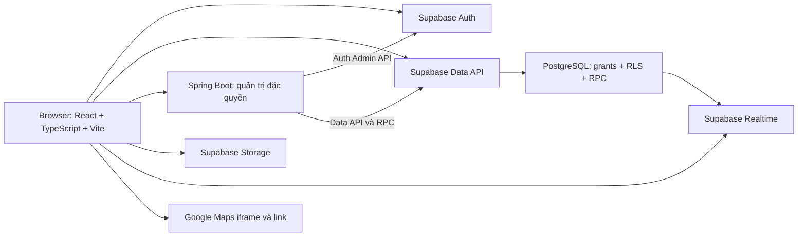

# Architecture — GrabMeFood

**Trạng thái:** DRAFT nhóm 2 — chờ duyệt; không có quyền triển khai.
**Nguồn phạm vi:** [PRD](PRD.md), [DOMAIN](DOMAIN.md).
Hướng browser/Supabase/Spring đã duyệt ở DEC-019; mọi chi tiết mới dưới đây là **đề xuất**,
không tự đóng các OQ trong [DECISIONS](DECISIONS.md).

## 1. Mục đích và phương án

Tận dụng nền tảng Supabase, giữ Spring là backend nghiệp vụ thực sự, không tạo gateway hoặc
một lớp CRUD proxy bao quanh toàn bộ Data API.

| Phương án | Đánh đổi | Trạng thái |
| --- | --- | --- |
| Browser dùng Supabase + Spring đặc quyền | Ít trùng lặp; phải kiểm chứng RLS và mọi đường truy cập | Hướng đã được chọn trong hội thoại |
| Mọi request đi qua Spring | Dễ nhìn một API tập trung nhưng nhân đôi plumbing và quyền | Không chọn vì trái ưu tiên tận dụng Supabase |
| Bỏ Spring, chỉ Supabase/Edge Functions | Ít runtime hơn nhưng bỏ yêu cầu công nghệ của chủ dự án | Không phù hợp |

## 2. Sơ đồ thành phần



Nếu chọn SSR, một Node renderer React/Vite bổ sung ở đường document công khai; nó chỉ đọc
nội dung công khai bằng quyền anon, không được dùng secret. Phần này chưa có trong hướng
kiến trúc đã duyệt và phải duyệt riêng ở mục 5.

## 3. Phân công theo luồng

| Luồng | Đường đề xuất | Vì sao |
| --- | --- | --- |
| Auth/email/Google/reset | Browser → Supabase Auth | Không tự xây password/session/email Auth |
| Đọc quán/món/bài viết/tuyển chọn | Browser → Data API, projection nhỏ, RLS public | Không cần server đặc quyền |
| Tìm tên quán/món, lọc vùng | Browser → RPC `search_restaurants` | Một truy vấn hợp nhất, loại trùng, phân trang, không thêm search engine |
| Đọc/đổi tên/xóa bộ, bỏ lưu | Browser → Data API theo grants/RLS | CRUD owner-only phù hợp; không mặc định xóa bộ là xóa quán |
| Thêm mục lưu | Browser → RPC `save_item` | Kiểm tra loại bộ, ownership và tính khả dụng trong cùng thao tác |
| Random | Browser → RPC `pick_saved_item` | Lọc và khử trùng ngay tại DB; tránh gửi toàn bộ danh sách xuống client |
| Gửi/sửa/xóa comment/reply | Browser → RPC có xác thực caller | Bảo vệ trường bất biến và notification transaction, không cho ghi thẳng bỏ qua nghiệp vụ |
| Đọc/đánh dấu thông báo | Browser → Data API; RPC cho mark-all có cutoff | Không cấp quyền sửa payload/người nhận |
| Nội dung quản trị | Browser → admin RPC bằng user JWT | Không cần đưa secret cho admin browser; quyền admin kiểm tra theo trạng thái hiện tại |
| Khóa/mở/xóa tài khoản | Browser → Spring → Auth Admin + RPC | Giữ đặc quyền server; điều phối nhiều dịch vụ và retry |
| Admin gửi thông báo | Browser → Spring → server-only RPC | Kiểm tra đối tượng nhận, idempotency và kết quả gửi |
| Ảnh | Đề xuất Browser → Storage theo policy | Không tự xây object storage/transformer; kiểm tra byte/staging có thể cần Spring, xem SECURITY G2-P12 |
| Chuông | Realtime Postgres Changes + đọc lại Data API | Supabase đã có; dữ liệu lưu DB, không dùng WebSocket làm nguồn chuẩn |

Mục CRUD bộ sưu tập còn có chi tiết sản phẩm chờ duyệt trong OQ-07.
Tên RPC/API trong tài liệu là hợp đồng đề xuất, không phải endpoint đang tồn tại.

## 4. Transaction và đặc quyền

- Một RPC = một transaction DB cho thay đổi và thông báo liên quan; lỗi phải rollback cả hai.
- Admin RPC trực tiếp dùng user JWT và kiểm tra `active + admin`, không dùng `user_metadata`.
- Wrapper RPC public dùng invoker; nghiệp vụ cần đặc quyền nằm trong schema `private` không exposed,
  với helper definer có grants chặt và kiểm tra caller. Mô hình quyền cụ thể ở SECURITY.
- Spring có hai HTTP context riêng: caller-context dùng publishable key + JWT của caller;
  privileged-context dùng secret cho Auth Admin/server-only RPC, không trộn Authorization headers.
- RPC server-only không thể được caller thường gọi, kể cả biết tên.
- Chưa cần Edge Functions, cron, Redis, broker hoặc microservices.
- Fan-out thông báo nhỏ cho demo có thể nằm trong transaction; phải đo số người nhận trước khi
  chốt giới hạn. Không hứa gửi hàng loạt không giới hạn trên Free.

### Spring: Data API hay JDBC?

| Nhu cầu | Đường đề xuất | Lý do / giới hạn |
| --- | --- | --- |
| Kiểm tra caller hiện tại | Caller-context RPC | Quyền/khóa cùng nguồn chuẩn với browser |
| Khóa/mở/xóa user | Auth Admin HTTP + server-only RPC | Auth không phải bảng ứng dụng để tự sửa bằng JDBC |
| Điều phối dữ liệu và notification | Data API gọi một RPC mỗi bước DB | Transaction ở DB, tránh hai bộ JPA mapping/schema |
| Migration/replay/admin | CLI hoặc công cụ PostgreSQL theo kế hoạch nhóm 3 | Có thể cần DB credential; chưa chọn đường và chưa cấp quyền |
| Truy vấn runtime khác | Chưa cần JDBC | Chỉ xem xét lại khi chứng minh Data API/RPC không phù hợp, không chỉ vì dễ làm |

## 5. SEO và chia sẻ — quyết định lớn chưa chốt

REQ-UX-03 yêu cầu HTML/meta riêng cho trang công khai, không chỉ thay `<title>` sau khi chạy JS.
Vite có API SSR và prerender chính thức; bản thân Vite không cung cấp sẵn một production server.

| Cách | Ưu điểm | Vấn đề cần duyệt |
| --- | --- | --- |
| **React/Vite SSR cho document public; CSR phần cá nhân** | Cùng component React, HTML và OG cập nhật theo nội dung hiện tại | Thêm Node runtime và hosting; **khuyến nghị kỹ thuật chờ duyệt**, chưa chọn plugin/framework |
| Prerender/SSG nội dung public | Có thể host static miễn phí, phù hợp dataset demo nhỏ | Sau ẩn/xóa/sửa phải rebuild và publish; HTML cũ có thể lộ nội dung đã ẩn |
| Spring render HTML public + React client | Không thêm Node runtime production | Thêm template/serialization phía Java; dễ nhân đôi hiển thị, cần thiết kế riêng |

SPA thuần + client-side meta không được coi là đáp ứng preview.
SSG chỉ được chọn nếu chủ dự án chấp thuận độ trễ xuất bản/ẩn và cơ chế rebuild; chưa có chấp thuận đó.
Không đổi sang Next.js, tự chọn hosting hay tự thêm một Node service.

## 6. Trust boundaries và dữ liệu

- Browser không đáng tin: role, owner, recipient, target và visibility đều phải xác minh server/DB.
- Supabase key public chỉ nhận diện ứng dụng, user JWT mới mang danh tính caller.
- PostgreSQL là nguồn chuẩn quyền ứng dụng và notification; Realtime chỉ báo thay đổi.
- Auth là nguồn chuẩn danh tính; không lưu password hoặc tự mint JWT.
- SMTP provider, Google OAuth, Google Maps là bên ngoài; không hứa không giới hạn/không phí.
- HTML public/SSR và bucket public không được chứa dữ liệu riêng hoặc nội dung ẩn.
- Client cache đã tải không thể thu hồi từ thiết bị người dùng. Thiết kế bảo đảm các request mới,
  không hứa xóa được screenshot/cache lịch sử trên Internet.

## 7. Khóa/xóa tài khoản và lỗi một phần

Đề xuất trạng thái nội bộ tài khoản `active / blocked / deletion_pending`, tách khỏi trạng thái nội dung.
Mọi RLS/RPC thao tác cá nhân kiểm tra active; Spring cũng kiểm tra lại, không chỉ tin JWT còn hạn.

```text
Khóa: commit blocked ở DB → Auth Admin ban → ghi kết quả operation
Mở: Auth Admin bỏ ban thành công → DB active → hoàn tất
Xóa: deletion_pending → xử lý Storage ownership → Auth Admin hard delete
      → FK/cleanup dữ liệu ứng dụng → xác minh hoàn tất
```

Các bước không tạo distributed transaction. Bước Auth lỗi thì giữ fail-closed và operation retryable,
không báo “đã hoàn tất”. Định nghĩa ranh giới khóa ứng dụng vs Auth sign-in trong lúc lỗi là
review blocker; chỉ coi khóa toàn luồng thành công khi cả hai bên đã xác nhận.

Đề xuất thêm guard bền vững `account_access.active_operation_id`: mỗi target chỉ có một operation
khóa/mở/xóa chưa kết thúc. Begin RPC dùng compare-and-set; operation khác trả conflict.
Guard sống xuyên các request Auth, không phải giữ transaction/row lock mở khi gọi HTTP.
Retry cùng ID phải theo đúng stage; trước gọi Auth và trước hoàn tất phải kiểm tra guard.
Lỗi/timeout giữ operation unresolved, không tự hết hạn guard rồi cho lệnh đối nghịch chạy;
recovery phải xác định kết quả request cũ trước khi giải phóng. Không có automatic worker/takeover đã được duyệt.

Không sao chép `blocked` vào JWT rồi chờ token refresh. Cách bootstrap account record, operation
idempotency và race admin cuối cần duyệt/test trước implementation.

## 8. Các quyết định review

Xem danh sách G2-P trong DECISIONS: SEO/runtime, phiên bản, dữ liệu marker,
vòng đời comment/reply, Storage và thông báo biên. Chưa có spike/build/test thực tế.
