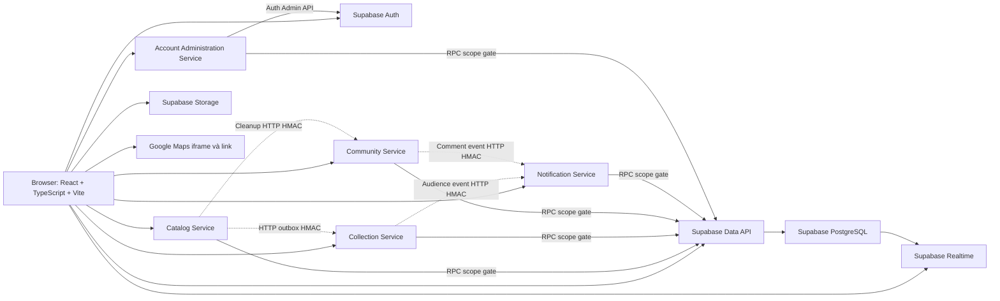

# Architecture — GrabMeFood

> Baseline B1: các hướng được xác nhận ở DEC-028..039 đã chốt; detailed contracts
> chưa kiểm chứng và các gate trong DECISIONS không tự trở thành implementation-ready.

**Trạng thái:** B1 về hướng kiến trúc; không có quyền triển khai hoặc evidence runtime.
**Nguồn phạm vi:** [PRD](PRD.md), [DOMAIN](DOMAIN.md).
**Đã duyệt:** DEC-025 — 5 microservices để học hệ thống phân tán, thay phạm vi Spring chỉ quản trị
trong DEC-019. Surface Supabase còn phù hợp tiếp tục được tận dụng.
Shared DB/schema-role riêng, HTTP outbox/inbox, helper quyền read-only, SSR và HMAC đã chốt.
Credential scope Data API/RPC còn GATE-01; các chi tiết khác không được xác nhận vẫn là candidate.

## 1. Mục đích và phương án

Tách theo nghiệp vụ, build/chạy/deploy độc lập; Supabase cung cấp capability nền tảng.
Không gọi năm module trong một JVM là microservices. Không biến mọi command thành proxy CRUD.

| Phương án | Đánh đổi | Trạng thái |
| --- | --- | --- |
| 2 service cho account/notification | Ít runtime, phạm vi học phân tán hẹp | Đã cân nhắc; user chọn phương án 5 service |
| 3 service, thêm content | Thêm ownership nghiệp vụ nhưng chưa tách các miền còn lại | Không chọn |
| **5 service theo miền nghiệp vụ** | Ranh giới rõ hơn; tăng công test, vận hành và failure modes | **User đã duyệt**; không có bằng chứng cần 5 service để chịu tải |
| Một Spring backend hoặc bỏ Spring | Ít runtime hơn | Không còn là kiến trúc mục tiêu đã duyệt |

| Service | Sở hữu | Không làm |
| --- | --- | --- |
| Catalog | Quán/món/khu vực/bài viết/tuyển chọn, availability, metadata ảnh | Không ghi saved/comments/inbox |
| Collection | Bộ sưu tập, mục lưu, random, audience người lưu | Không sửa Catalog hoặc inbox |
| Community | Comment/reply, quyền tác giả, moderation | Không ghi inbox hoặc tự sửa account |
| Notification | Inbox/read state, gửi thông báo, Realtime signal | Không quét trực tiếp bảng các service khác |
| Account Administration | App role/state, account-operation ledger, điều phối Auth Admin/cleanup | Không tự quản lý password/OAuth hoặc DELETE bảng service khác |

Supabase Auth/Storage/Realtime/PostgreSQL không tính thành các service nghiệp vụ tự xây.
SSR renderer React/Vite đã chọn, là runtime trình bày bổ sung, không service nghiệp vụ thứ sáu.

## 2. Sơ đồ thành phần



Đường Browser → Data API chỉ tới read surface được owner duyệt; không tới bảng nội bộ tùy ý.
HTTP outbox đã chọn, chưa Gateway/broker. Đường RPC trong sơ đồ còn phải vượt scope gate,
không phải bằng chứng gọi được. Node SSR chỉ đọc public surface, không dùng secret;
hosting vẫn cần duyệt, không cam kết đủ free.

## 3. Phân công theo luồng

| Luồng | Đường đề xuất | Vì sao |
| --- | --- | --- |
| Auth/email/Google/reset | Browser → Supabase Auth | Không tự xây password/session/email Auth |
| Đọc quán/món/bài viết/tuyển chọn | Browser → Catalog-owned public Data API projection hoặc Catalog API | Khuyến nghị Data API cho read đơn giản; không lộ hidden payload |
| Tìm tên quán/món, lọc vùng | Browser → Catalog public search RPC/API | Chỉ dữ liệu Catalog; không thêm search engine |
| Đọc/ghi bộ sưu tập, lưu/bỏ lưu | Browser → Collection API | Owner service giữ rule; có thể expose read model owner-only sau review, không direct writes bỏ qua service |
| Random | Browser → Collection → Catalog batch availability API | Chỉ saved distinct; không tin projection availability chậm |
| Bình luận/reply/moderation | Browser → Community → Catalog kiểm tra target | Local transaction comment + outbox; Notification xử lý độc lập |
| Đọc inbox/unread | Browser → Notification-owned Data API read surface | RLS recipient+active; không cấp quyền payload cho client |
| Đánh dấu đọc, mark-all | Browser → Notification API | Notification sở hữu read-state và cutoff |
| Nội dung quản trị | Browser → Catalog API | Catalog local transaction, không ghi schema khác |
| Khóa/mở/xóa tài khoản | Browser → Account Administration → Auth Admin + owner cleanup APIs | Đặc quyền riêng và theo dõi từng bước |
| Admin gửi thông báo | Browser → Notification API | Service kiểm tra admin và audience |
| Ảnh | Browser → private staging Storage → Catalog validate/finalize → public Storage | Đã chọn, chưa tạo bucket; không xây Media Service |
| Chuông | Realtime Postgres Changes + đọc lại Data API | Supabase đã có; dữ liệu lưu DB, không dùng WebSocket làm nguồn chuẩn |

Đây là đề xuất routing mới, thay các browser mutation RPC trực tiếp trong bản nháp cũ.
Không bắt mọi request qua Spring: Auth/public reads/inbox reads/Storage/Realtime vẫn tận dụng Supabase.
Tên API/RPC là hợp đồng review, chưa tồn tại. CRUD bộ sưu tập vẫn có OQ-07.

## 4. Transaction và đặc quyền

- Transaction/RPC chỉ trong dữ liệu owner: command + outbox, không ghi inbox của service khác.
- Nhận event: consumer ghi receipt + dữ liệu của mình + outbox tiếp theo (nếu có) trong local transaction.
- Không FK/cascade/join nghiệp vụ xuyên owner, dù cùng PostgreSQL có thể làm được.
- Shared read-only security helper là ngoại lệ đã duyệt DEC-031; service khác không được ghi account state.
- Supabase secret keys khác nhau vẫn có thể cùng quyền `service_role`; không coi đó là isolation.
- Auth Admin secret chỉ Account Administration; Catalog có quyền Storage cần thiết theo G2-P12.
- Không mặc định Gateway, service discovery, broker, Kubernetes, Redis hoặc Edge Functions.

### Event delivery — HTTP outbox/inbox đã duyệt DEC-030

| Phương án | Đánh đổi |
| --- | --- |
| **Outbox/inbox + HTTP authenticated giữa owner** | Đã chọn: poller trong owner; còn thiết kế lease/recovery/delivery |
| Outbox + broker | Không chọn hiện tại; muốn thêm phải xin duyệt |
| Chỉ gọi HTTP sau commit | Đơn giản nhưng crash có thể mất sự kiện; không khuyến nghị cho các thông báo bắt buộc |

Poller nằm trong từng owner service (không tạo service thứ sáu);
lease/claim và delivery record theo từng consumer, retry có backoff, receipt unique theo event ID.
Không dùng Supabase Realtime làm durable inter-service queue. Không tuyên bố exactly-once;
consumer phải chịu được at-least-once và event sai thứ tự, version cũ hoặc gap.
Không xóa outbox trước durable acknowledgement, không mark toàn event delivered khi mới một consumer nhận.

### Spring: Data API hay JDBC?

| Nhu cầu | Đường đề xuất | Lý do / giới hạn |
| --- | --- | --- |
| Owned writes/transaction/outbox của mỗi service | **Ưu tiên Data API/RPC** bằng role/context giới hạn đã được chứng minh | GATE-01: dừng implementation persistence/quyền phụ thuộc proof, vẫn làm preparation độc lập; không tự chọn JDBC thay |
| Public reads/search | Data API/RPC Catalog-owned | Tận dụng nền tảng, không cần privileged credential |
| Inbox read/Realtime | Data API/RLS Notification-owned | Không tự xây WebSocket |
| Kiểm tra quyền hiện tại | Account-owned shared DB read-only contract | Đã duyệt exception; RLS và service kiểm tra current state, không user metadata |
| Auth Admin | Account Administration → Auth Admin HTTP | Không tự sửa bảng Auth bằng JDBC |
| Migration/replay/admin | CLI hoặc công cụ PostgreSQL theo kế hoạch nhóm 3 | Có thể cần DB credential; chưa chọn đường và chưa cấp quyền |

Auth Admin vẫn HTTP riêng. Data API/RPC priority không hứa không cần DB credential cho migration/admin.
HMAC giữa service không xác thực role khi vào Supabase; cần proof độc lập, không tự mint JWT/signing keys.

## 5. SEO và chia sẻ — SSR đã chọn DEC-032

REQ-UX-03 yêu cầu HTML/meta riêng cho trang công khai, không chỉ thay `<title>` sau khi chạy JS.
Vite có API SSR và prerender chính thức; bản thân Vite không cung cấp sẵn một production server.

| Cách | Ưu điểm | Vấn đề cần duyệt |
| --- | --- | --- |
| **React/Vite SSR public; CSR private** | Cùng component React, HTML và OG theo trang | **Đã chọn**; plugin/version và host còn gate |
| Prerender/SSG nội dung public | Có thể host static | Phương án đã cân nhắc, không chọn; stale HTML sau hide |
| Spring render HTML public + React client | Không thêm Node runtime | Phương án đã cân nhắc, không chọn |

SPA thuần + client-side meta không được coi là đáp ứng preview.
SSG chỉ được chọn nếu chủ dự án chấp thuận độ trễ xuất bản/ẩn và cơ chế rebuild; chưa có chấp thuận đó.
Không đổi Next.js hoặc tự chọn host. Node renderer đã được duyệt về vai trò, chưa được deploy.

## 6. Trust boundaries và dữ liệu

- Browser không đáng tin: role, owner, recipient, target và visibility đều phải xác minh server/DB.
- Supabase key public chỉ nhận diện ứng dụng, user JWT mới mang danh tính caller.
- Mỗi miền chỉ có một owner nguồn chuẩn; bản sao/projection không tự được sửa dữ liệu nguồn.
- Account Administration là nguồn chuẩn quyền; Notification là nguồn chuẩn inbox; Realtime chỉ báo thay đổi.
- Auth là nguồn chuẩn danh tính; không lưu password hoặc tự mint JWT.
- SMTP provider, Google OAuth, Google Maps là bên ngoài; không hứa không giới hạn/không phí.
- HTML/JSON public/SSR không được chứa payload riêng/ẩn. Ảnh public là ngoại lệ đã chấp thuận:
  URL ảnh cũ có thể còn đọc khi nội dung bị ẩn, không coi đó là dữ liệu bí mật.
- Client cache đã tải không thể thu hồi từ thiết bị người dùng. Thiết kế bảo đảm các request mới,
  không hứa xóa được screenshot/cache lịch sử trên Internet.

## 7. Khóa/xóa tài khoản và lỗi một phần

Đề xuất trạng thái nội bộ tài khoản `active / blocked / deletion_pending`, tách khỏi trạng thái nội dung.
Account Administration sở hữu trạng thái và operation guard; mọi service/read surface cá nhân kiểm tra
quyền hiện tại. Chỉ event-propagated blocked state không đủ cho yêu cầu khóa phiên đang mở.

```text
Khóa: commit blocked ở DB → Auth Admin ban → ghi kết quả operation
Mở: Auth Admin bỏ ban thành công → DB active → hoàn tất
Xóa: deletion_pending → yêu cầu Collection/Community/Notification cleanup và Catalog xử lý ownership ảnh
      → thu đủ receipt → Auth Admin hard delete → xác minh không tái tạo dữ liệu từ event trễ
```

Các bước không tạo distributed transaction. Bước Auth lỗi thì giữ fail-closed và operation retryable,
không báo “đã hoàn tất”. Định nghĩa ranh giới khóa ứng dụng vs Auth sign-in trong lúc lỗi là
review blocker; chỉ coi khóa toàn luồng thành công khi cả hai bên đã xác nhận.

Đề xuất thêm guard bền vững `account_access.active_operation_id`: mỗi target chỉ có một operation
khóa/mở/xóa chưa kết thúc. Begin RPC dùng compare-and-set; operation khác trả conflict.
Guard sống xuyên các request Auth và cleanup owner APIs, không giữ transaction/row lock mở khi gọi HTTP.
Retry cùng ID phải theo đúng stage; trước gọi Auth và trước hoàn tất phải kiểm tra guard.
Lỗi/timeout giữ operation unresolved, không tự hết hạn guard rồi cho lệnh đối nghịch chạy;
recovery phải xác định kết quả request cũ trước khi giải phóng. Không có automatic worker/takeover đã được duyệt.

Không sao chép `blocked` vào JWT rồi chờ token refresh. Cách bootstrap account record, operation
idempotency và kiểm chứng race còn phải hoàn thiện. Quy tắc không tự khóa/xóa admin hoặc
admin active cuối đã chốt; admin đầu do chủ dự án chỉ định và duyệt thao tác cấp riêng.

## 8. Các quyết định review

### Các luồng cross-owner cần bảo toàn nghiệp vụ

| Luồng | Owner và phối hợp đề xuất | Không được hứa |
| --- | --- | --- |
| Thêm món | Catalog commit món public+event; Collection xác định user đã save lúc event và còn save lúc gửi; Notification tạo inbox | Không transaction Catalog/inbox; history/two-time proof còn gate |
| Reply/admin xóa comment | Community commit + event mang ID người nhận tối thiểu; Notification consume | Không lấy raw nội dung comment đã xóa làm notification snapshot |
| Ẩn quán | Catalog chặn đọc ở nguồn; hidden event cập nhật Collection/notification audience; Community giữ comments, kiểm tra Catalog trước đọc | Không xóa comment chỉ vì target không khả dụng |
| Xóa quán | Catalog chặn đọc và phát deleted event; Collection giữ marker; Community cleanup theo deletion scope có receipt | Không coi hidden event như deleted hoặc báo cleanup xong khi thiếu receipt |
| Random | Collection lấy candidate own, Catalog batch validate ngay trước trả; lỗi dependency trả lỗi retryable | Không fallback sang stale projection hoặc coi timeout là không có quán |
| Xóa user | Account Administration điều phối cleanup từng owner, giữ deny gate/guard đến đủ receipt và Auth delete | Không dùng FK Auth cascade để xóa xuyên các service |

Community đọc/gửi comment phải kiểm tra Catalog authoritative; chi tiết chống race check→commit,
consistency window, tombstone và cleanup completion còn G2-P16. Không hứa zero-latency cross-service atomicity.
Progress xóa đã duyệt: chặn trước, đang xử lý, đủ receipt mới hoàn tất, lỗi retry an toàn.
Deadline/latency, retention và recovery chi tiết vẫn mở, không tự nới requirement.

G2-P13..18 bổ sung cho quyết định 5 service: storage vật lý, routing, delivery, consistency,
authorization contract và runtime DB connection. Xem trạng thái lựa chọn hiện hành trong DECISIONS,
không diễn giải lại hướng đã chốt thành chưa chọn; chưa có spike/build/test.

Tham khảo nguyên tắc, không áp stack của ví dụ:
[Data sovereignty](https://learn.microsoft.com/en-us/dotnet/architecture/microservices/architect-microservice-container-applications/data-sovereignty-per-microservice),
[Transactional outbox](https://docs.aws.amazon.com/prescriptive-guidance/latest/cloud-design-patterns/transactional-outbox.html).
