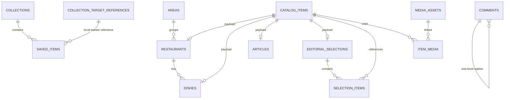

# Database design — GrabMeFood

> B1 đã chọn schema/role riêng cùng Supabase DB và Data API/RPC ưu tiên.
> Chi tiết schema/constraint vẫn là thiết kế chưa executable, chịu GATE-01 và review migration.

**Trạng thái:** DRAFT nhóm 2. Toàn bộ tên bảng/cột/constraint dưới đây là **đề xuất chờ duyệt**.
Không có SQL executable hoặc migration được tạo/chạy.
Quy tắc nghiệp vụ: [DOMAIN](DOMAIN.md); quyền chi tiết: [SECURITY](SECURITY.md).
**Bản chỉnh 5 service:** bỏ mô hình bảng/FK/transaction dùng chung trong bản nháp trước.
Owner/layout shared DB đã duyệt; tên schema/bảng, migration tooling và role/token mechanics còn phải kiểm chứng.

## 1. Hiện trạng và chiến lược

Khảo sát chỉ đọc: PostgreSQL 17.11, `public` không có bảng; có `rls_auto_enable()` và event trigger
`ensure_rls`, publication `supabase_realtime`. Extensions quan sát được: pg_stat_statements,
pgcrypto, plpgsql, supabase_vault, uuid-ossp. Không giả định tài nguyên này được reset.

So sánh mô hình lưu mục đã xóa:

| Cách | Đánh đổi |
| --- | --- |
| Giữ cả row quán/món và soft-delete | Dễ FK nhưng giữ toàn bộ nội dung dù user chọn xóa |
| Snapshot tên/ảnh trong mỗi mục lưu | Dễ hiện dấu nhưng trùng nội dung, khó xóa triệt để |
| **Registry ID tối thiểu + xóa payload** | Giữ FK/marker mà không giữ nội dung; thêm registry nhưng dùng chung cho content/reply/ảnh |

Khuyến nghị registry tối thiểu chỉ do Catalog sở hữu. Collection giữ **reference riêng** để bảo toàn marker,
không FK đến registry Catalog và không snapshot tên/ảnh/nội dung đã xóa mặc định.
Catalog xóa payload/media links thuộc mình; Community xóa comment qua cleanup workflow riêng.
G2-P04 và consistency/completion G2-P16 chưa duyệt; không gọi đây là hard delete toàn bộ mọi row.

### Vật lý và logical ownership — shared DB đã chọn DEC-028

| Phương án | Ưu điểm | Giới hạn |
| --- | --- | --- |
| Schema riêng/role riêng trong cùng Supabase PostgreSQL | **Đã chọn**; dùng project hiện có khi có quyền | Chung compute, outage, backup; không là DB vật lý riêng |
| Database/project riêng từng service | Cô lập và lifecycle tốt hơn | Chưa chứng minh đáp ứng giới hạn miễn phí và quản trị nền tảng |

Ký hiệu schema đề xuất trong phần còn lại: `catalog`, `collection`, `community`, `notification`, `account_admin`.
Không tự tạo schema, role, project, pool hoặc đổi exposed schemas.
Ngay cả khi cùng DB: không join/FK/cascade/trigger mutation xuyên owner; không transaction cross-owner.
Ngoại lệ read-only security contract đã duyệt DEC-031; không biến thành quyền đọc mọi bảng.

## 2. Quy ước

- `id uuid` default sinh phía DB; thời gian `timestamptz` UTC; `created_at`, `updated_at` do DB.
- Payload nội dung có `version bigint` tăng khi sửa để phát hiện stale write.
- `locale` chỉ vi/en nếu dùng cấu trúc translation; đề xuất ban đầu dùng cặp cột vi/en để gọn.
- User ID và target ID xuyên owner là opaque reference, không FK đến bảng service khác hoặc Auth để cascade.
  Không tham chiếu cột nội bộ Auth; kiểm tra danh tính qua Auth/Account contract, không dựa vào FK.
- Ownership/role/status không nhận như dữ kiện đáng tin từ browser.
- `public` chỉ là façade read-only đề xuất do từng owner quản lý; schema nội bộ không exposed.
  Role service chỉ ghi schema mình. Grant cho read view/RLS cần test, không assume invoker view tự hoạt động.
  Không tự đổi Exposed schemas trên Cloud.

## 3. ERD đề xuất



Sơ đồ chỉ thể hiện FK **nội bộ owner**: Catalog, Collection hoặc Community. Không có FK Auth→service,
Catalog→comments/saved/notifications. Account và Notification có dữ liệu độc lập mô tả bên dưới.
ID tham chiếu không có đường nối không có nghĩa không có quan hệ nghiệp vụ.

## 4. Bảng/cột và constraints

| Bảng | Cột chính đề xuất | Constraints / vòng đời |
| --- | --- | --- |
| `account_admin.account_access` | user_id PK, role user/admin, state active/blocked/deletion_pending, active_operation_id nullable FK operations, version | Không client ghi; thiếu row deny; không cascade theo Auth; minimal deny tombstone/retention cần duyệt |
| `account_admin.profiles` | user_id PK, display_name, created_at | Own read qua contract, không public email/password; không FK Auth |
| `account_admin.operations` | id, actor_id, target_user_id, kind, input_hash, stage, error_code, created_at, completed_at | Idempotency; guard xuyên request; target không FK để operation sống qua xóa Auth |
| `account_admin.cleanup_receipts` | operation_id FK, owner_service, scope, result, completed_at | unique(operation_id,owner_service,scope); không chứa bản sao dữ liệu đã xóa |
| `catalog.areas` | id, code, name_vi, name_en | code unique; danh mục 3 nhóm; chưa duyệt quản lý taxonomy UI |
| `catalog.catalog_items` | id, kind, visibility, deleted_at, version, created_at, updated_at | unique(id,kind); không payload, marker/catalog authority |
| `catalog.restaurants` | item_id PK/FK, kind=restaurant, name, description_vi/en, address, area_id FK, maps_url, embed_url, source_url, source_checked_at | Composite FK registry; một khu vực/quán là proposal |
| `catalog.dishes` | item_id PK/FK, kind=dish, restaurant_id FK, name_vi/en, description_vi/en, price_vnd | Composite FK; price integer>=0, giá demo; cascade payload quán chỉ trong Catalog |
| `catalog.articles` | item_id PK/FK, kind=article, title_vi/en, summary_vi/en, body_vi/en | Markdown không raw HTML; composite FK |
| `catalog.editorial_selections` | item_id PK/FK, kind=selection, title_vi/en, description_vi/en | Composite FK |
| `catalog.selection_items` | selection_id FK, target_item_id FK, position | PK(selection_id,target_item_id); chỉ link nội dung Catalog hợp lệ |
| `catalog.media_assets`, `catalog.item_media` | id/bucket/path/MIME/size/provenance; item_id/media_id FK, position, alt_vi/en | Path unique; validation state/hash theo G2-P12; không user comment upload |
| `collection.collections` | id, owner_id, kind restaurant/dish, name, created_at | unique(id,kind,owner_id); owner opaque ID, không FK Auth |
| `collection.target_references` | item_id, kind, restaurant_id nullable, source_version, last_known_state, deleted_at nullable | PK(item_id,kind); metadata tối thiểu do event/API cập nhật; không là authority availability |
| `collection.saved_items` | collection_id, item_id, kind, owner_id, created_at | PK(collection_id,item_id); local FK(collection_id,kind,owner_id) và target_references; không FK Catalog |
| `community.comments` | id, target_item_id, target_kind, author_id, parent_id nullable, body, created_at, edited_at, version | Target/author opaque ID; parent local FK/cùng target/kind, một cấp; parent delete cascade replies kể cả khác author |
| `notification.notifications` | id, recipient_id, event_key, type, message_key+params hoặc title_vi/en, target_item_id/comment_id nullable, read_at, created_at | unique(recipient_id,event_key); không FK target/recipient xuyên service; không quote comment đã xóa |
| `notification.notification_signals` | user_id PK, revision bigint | Tín hiệu không nội dung, chỉ INSERT/UPDATE; không FK Auth |
| Mỗi owner: `operations`, `outbox`, `event_receipts`, `event_deliveries` | operation/input hash; event envelope; consumer/event receipt; delivery state/attempts | HTTP outbox/inbox đã chọn; FK/transaction chỉ trong owner, không ledger dùng chung |

Không tự thêm giờ mở cửa, điện thoại, giá trung bình, tọa độ, dietary flags hoặc chứng nhận chỉ vì tham chiếu
có chúng. Nếu cần thì xin quyết định riêng.
Trường mục tuyển chọn và account display_name là đề xuất thiết kế, không mở thêm trang hồ sơ công khai.
Guard account tham chiếu ledger operation cùng owner, không FK ngược operation bắt buộc tồn tại user sau xóa.
Operation khác ID không được chiếm cùng target cho đến hoàn tất/reconcile; timeout HTTP không tự giải phóng.
Không chỉ dùng unique operation ID để tuyên bố đã chặn race giữa lock/unlock/delete.

## 5. Tính khả dụng và vòng đời

Nguồn chuẩn là biểu thức, không lưu hai bản trạng thái cha/con dễ lệch:

```text
Quán khả dụng = registry visibility public AND deleted_at null AND payload tồn tại
Món khả dụng = registry món public AND chưa xóa AND payload tồn tại AND quán cha khả dụng
```

Ẩn quán không ghi đè visibility riêng của món. Đề xuất khi hiện lại quán: chỉ các món vốn public hiện lại;
món ẩn riêng vẫn ẩn. Đây là G2-P04, phải duyệt.
Ẩn không xóa bình luận/reply. Hidden event chỉ đổi availability/marker/audience; chỉ deletion event/command
có lifecycle rõ mới yêu cầu Community xóa dữ liệu. Không dùng một tín hiệu unavailable chung để cascade.

Xóa quán qua Catalog command, đề xuất:
1. Catalog transaction mark registry quán/món không khả dụng, xóa payload/media links và ghi outbox.
   Catalog **không đọc saved hoặc xóa comments** trong transaction này.
2. Collection consume ID/version để giữ marker và xác định audience qua dữ liệu do mình sở hữu.
3. Community cleanup comments/replies theo target scope, ghi receipt; Notification tạo inbox từ event hợp lệ.
4. Operation chỉ hoàn tất cleanup toàn luồng khi đủ owner receipt; Storage object cleanup retry riêng,
   không xóa asset dùng chung. Độ trễ/thu hồi và liveness chưa duyệt G2-P16.

Không chạy `DELETE restaurants` từ browser để bỏ qua các bước trên.
Quy tắc giữ/xóa marker tối thiểu và cách người dùng tự bỏ marker phải duyệt.

### Bình luận và user bị xóa

Constraint Community chỉ cho parent là comment gốc cùng target/kind; không thể đổi author/target/parent khi sửa.
Parent delete cascade replies nội bộ Community đã được user chọn; user bị xóa cũng xóa comments
của mình và mọi replies dưới các comment gốc đó, kể cả của người khác.
Khi target quán/món bị xóa, tất cả comments/replies target đó bị xóa theo quyết định đã duyệt.
Đó là cleanup do Community thực hiện, không phải FK cross-service cascade.
Xóa user do Account Administration điều phối owner cleanup, không dựa Auth FK. Giữ deny gate/receipts
cho đến hoàn tất; event trễ không được tái tạo saved/comments/inbox của user đã xóa.
Thời hạn giữ minimal tombstone và dữ liệu operation là quyết định quyền dữ liệu cần duyệt.

## 6. Indexes đề xuất

- Tất cả FK dùng join/cascade phải đánh giá index: dishes.restaurant_id, restaurants.area_id,
  comments.author_id, item_media.media_id, saved_items.item_id.
- Collections(owner_id,kind,created_at,id); saved_items(owner_id,kind,item_id) để union/dedup random.
- Comments(target_item_id,parent_id,created_at,id), comments(parent_id).
- Notifications(recipient_id,created_at desc,id desc), partial unread(recipient_id) where read_at null.
- Catalog(kind,visibility,created_at,id) where deleted_at null.
- Unique keys cho event dedup và operation idempotency.
- Không cài pg_trgm/unaccent ở giai đoạn tài liệu; tìm substring phải đo trước chọn index/extension.
- Đo EXPLAIN có RLS, không chỉ query dưới postgres/service_role.

## 7. Functions/triggers đề xuất

- Bootstrap account_access/profiles do Account Administration sở hữu; Auth lifecycle hook/trigger hoặc
  verified-login bootstrap chưa chọn. Không copy role từ metadata, không ghi nhiều schema từ Auth trigger.
  Thiếu state thì fail-closed, không auto active khi gặp event cũ.
- Timestamp/version triggers bảo vệ cột server-owned.
- RPC/SQL helpers theo owner contract; không helper tiện dụng truy cập toàn bộ database.
- Mọi đường mutation bị giới hạn qua grant; không chỉ dựa vào việc UI gọi RPC.
- Producer transaction chỉ ghi local mutation + outbox. Notification consume transaction ghi receipt,
  inbox + revision; không bắt Catalog/Community ghi Notification. Publication chỉ signal read surface.
  Signal phải là bảng thật `notification.notification_signals`, không façade view; grants/custom schema
  và publication cần test riêng, không tự bật toàn bộ schema.
- Không sửa `rls_auto_enable()`/`ensure_rls` hiện có khi chưa đánh giá/xin quyền; migration vẫn enable RLS rõ ràng.

## 8. Migration và seed

- Đề xuất migration theo owner service; cách replay/thứ tự phụ thuộc security contract là G2-P13/G2-P17.
  Chưa chốt Supabase CLI root hay per-service migration tooling, không tự tạo hai nguồn migration cạnh tranh.
- Bundle bảng, grants, RLS, helper EXECUTE và constraints trong cùng thay đổi có test.
- Seed chỉ chạy khi duyệt target/số lượng/nguồn, không hardcode ID do Cloud sinh.
- Bản dịch/ảnh/nguồn được kiểm tra trước publish; không seed user thật hoặc secret.
- Trước push Cloud phải kiểm tra hiện trạng/drift, approval và cleanup; không reset Cloud để “cho khớp”.
- Operations/backup/rollback chi tiết thuộc nhóm 3, chưa có lệnh chạy được phê duyệt.

## 9. Projection, delivery và retention

- Projection do consumer sở hữu, ghi bằng event có source version hoặc kết quả authoritative API;
  không join nguyên tables Catalog/Account từ service khác để “đỡ gọi HTTP”.
- Không dùng projection chậm làm quyết định cuối cho random/hiển thị comment target đã ẩn.
  Cơ chế authoritative check và TOCTOU window cần chốt ở G2-P16.
- Outbox đã chọn: event ID bất biến, aggregate ID/version, payload tối thiểu, delivery theo consumer,
  receipt unique; schema envelope tại API. Event version cũ không ghi đè version mới.
- Audience đã chốt: đã save tại event và còn save khi xử lý gửi. Cần thiết kế historical membership/
  snapshot tối thiểu và kiểm tra current-state; không chỉ query saved hiện tại hoặc lưu history vô hạn.
  Re-save qua khoảng trống, xử lý boundary/clock/version và chính xác thời điểm gửi còn GATE-03.
- Các retention user deletion/tombstone/event payload/receipts phải thống nhất trước migration.
