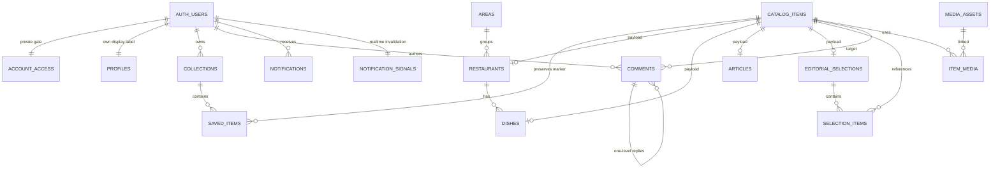

# Database design — GrabMeFood

**Trạng thái:** DRAFT nhóm 2. Toàn bộ tên bảng/cột/constraint dưới đây là **đề xuất chờ duyệt**.
Không có SQL executable hoặc migration được tạo/chạy.
Quy tắc nghiệp vụ: [DOMAIN](DOMAIN.md); quyền chi tiết: [SECURITY](SECURITY.md).

## 1. Hiện trạng và chiến lược

Khảo sát chỉ đọc: PostgreSQL 17.11, `public` không có bảng; có `rls_auto_enable()` và event trigger
`ensure_rls`, publication `supabase_realtime`. Extensions quan sát được: pg_stat_statements,
pgcrypto, plpgsql, supabase_vault, uuid-ossp. Không giả định tài nguyên này được reset.

So sánh mô hình lưu mục đã xóa:

| Cách | Đánh đổi |
| --- | --- |
| Giữ cả row quán/món và soft-delete | Dễ FK nhưng giữ toàn bộ nội dung dù user chọn xóa |
| Snapshot tên/ảnh trong mỗi mục lưu | Dễ hiện dấu nhưng trùng nội dung, khó xóa triệt để |
| **Registry ID tối thiểu + xóa payload** | Giữ FK/marker mà không giữ nội dung; thêm registry nhưng dùng chung cho content/reply/ảnh |

Khuyến nghị cách thứ ba: `catalog_items` giữ ID, loại và trạng thái, không tên/địa chỉ/mô tả.
Khi xóa, xóa payload, translation, media links và comments; giữ registry cho marker.
Đây là quyết định thiết kế cần duyệt (G2-P04), không tự gọi là hard delete toàn bộ mọi row.

## 2. Quy ước

- `id uuid` default sinh phía DB; thời gian `timestamptz` UTC; `created_at`, `updated_at` do DB.
- Payload nội dung có `version bigint` tăng khi sửa để phát hiện stale write.
- `locale` chỉ vi/en nếu dùng cấu trúc translation; đề xuất ban đầu dùng cặp cột vi/en để gọn.
- FK tham chiếu Auth chỉ đến `auth.users.id`, không phụ thuộc cột nội bộ khác.
- Ownership/role/status không nhận như dữ kiện đáng tin từ browser.
- `public` chứa surface cần Data API; `private` không exposed chứa account state/helpers/operation ledger.
  Không tự đổi Exposed schemas trên Cloud.

## 3. ERD đề xuất



Auth là schema nền tảng; các tên in hoa trong sơ đồ là khái niệm, không bảng đã tạo.

## 4. Bảng/cột và constraints

| Bảng | Cột chính đề xuất | Constraints / vòng đời |
| --- | --- | --- |
| `private.account_access` | user_id PK/FK, role user/admin, state active/blocked/deletion_pending, active_operation_id nullable FK operations, updated_at | FK Auth cascade; không cho client ghi; fail-closed khi thiếu; guard tuần tự hóa thao tác cùng target |
| `public.profiles` | user_id PK/FK, display_name, created_at | Own read; không email/password/role; FK cascade |
| `public.areas` | id, code, name_vi, name_en | code unique; danh mục 3 nhóm ban đầu; chưa duyệt quản lý taxonomy qua UI |
| `public.catalog_items` | id, kind restaurant/dish/article/selection, visibility public/hidden, deleted_at, version, created_at, updated_at | unique(id,kind); marker đã xóa không bao giờ khả dụng; không lưu payload |
| `public.restaurants` | item_id PK/FK, kind=restaurant, name, description_vi/en, address, area_id FK, maps_url, embed_url, source_url, source_checked_at | Composite FK(item_id,kind); tên thật dùng nguyên dạng; một khu vực/quán là đề xuất cần duyệt |
| `public.dishes` | item_id PK/FK, kind=dish, restaurant_id FK, name_vi/en, description_vi/en, price_vnd | Composite FK đảm bảo kind; price>=0, integer; giá luôn nhãn demo; FK quán cascade payload |
| `public.articles` | item_id PK/FK, kind=article, title_vi/en, summary_vi/en, body_vi/en | Composite FK; body Markdown giới hạn, không raw HTML |
| `public.editorial_selections` | item_id PK/FK, kind=selection, title_vi/en, description_vi/en | Composite FK |
| `public.selection_items` | selection_id FK, target_item_id FK, position | PK(selection_id,target_item_id); target đề xuất chỉ quán/món, cần duyệt; bỏ ẩn/xóa khỏi public projection |
| `public.collections` | id, owner_id FK, kind restaurant/dish, name, created_at | unique(id,kind,owner_id) cho composite FK; kind bất biến sau tạo là đề xuất |
| `public.saved_items` | collection_id, item_id, kind, owner_id, created_at | PK(collection_id,item_id); FK(collection_id,kind,owner_id), FK(item_id,kind); owner lấy auth.uid; registry không cascade khi xóa payload |
| `public.comments` | id, target_item_id FK, author_id FK, parent_id nullable, body, created_at, edited_at, version | Target chỉ quán/món; parent cùng target, parent phải gốc; author FK cascade; xử lý delete parent là blocker |
| `public.notifications` | id, recipient_id FK, event_key, type, title_vi/en hoặc message_key+params, target_item_id nullable, target_comment_id nullable, read_at, created_at | unique(recipient_id,event_key); payload không chứa lời đã xóa/địa chỉ email; recipient FK cascade |
| `public.notification_signals` | user_id PK/FK, revision bigint | Một row/user; chỉ báo invalidation không payload; FK cascade; publish INSERT/UPDATE có kiểm soát |
| `public.media_assets` | id, bucket, object_path, mime_type, size_bytes, source_kind, credit_vi/en, origin_url, license_id_or_text, is_illustration | path unique; nguồn/quyền bắt buộc theo source_kind; không dùng user upload bình luận; validation state/hash nếu chọn G2-P12 staging, chưa chốt |
| `public.item_media` | item_id FK, media_id FK, position, alt_vi/en | PK(item_id,media_id); không coi ảnh không có alt là hoàn thành nội dung |
| `private.operations` | id, actor_id nullable, target_user_id nullable, kind, state, input_hash, stage, error_code, created_at, completed_at | Idempotency key; không password/token; PII retention và FK khi xóa user cần duyệt |
| `private.event_receipts` | operation_id, event_key, created_at | unique event_key; khử trùng transaction/retry; không phải queue/broker |

Không tự thêm giờ mở cửa, điện thoại, giá trung bình, tọa độ, dietary flags hoặc chứng nhận chỉ vì tham chiếu
có chúng. Nếu cần thì xin quyết định riêng.
Trường mục tuyển chọn và account display_name là đề xuất thiết kế, không mở thêm trang hồ sơ công khai.
Guard account tham chiếu ledger operation nội bộ, không FK ngược operation bắt buộc tồn tại user sau xóa.
Operation khác ID không được chiếm cùng target cho đến hoàn tất/reconcile; timeout HTTP không tự giải phóng.
Không chỉ dùng unique operation ID để tuyên bố đã chặn race giữa lock/unlock/delete.

## 5. Tính khả dụng và vòng đời

Nguồn chuẩn là biểu thức, không lưu hai bản trạng thái cha/con dễ lệch:

```text
Quán khả dụng = registry visibility public AND deleted_at null AND payload tồn tại
Món khả dụng = registry món public AND chưa xóa AND payload tồn tại AND quán cha khả dụng
```

Ẩn quán không ghi đè visibility riêng của món. Đề xuất khi hiện lại quán: chỉ các món vốn public hiện lại;
món ẩn riêng vẫn ẩn. Đây là G2-P04, phải duyệt.

Xóa quán qua RPC phải:
1. Chụp tập người lưu quán và món liên quan, distinct theo sự kiện/người nhận.
2. Mark registry quán và registry của tất cả món, xóa payload và comment/reply.
3. Xóa payload/media links liên quan; không xóa nhầm asset còn nơi khác dùng.
4. Giữ marker và tạo thông báo cùng transaction; Storage object cleanup là việc ngoài DB cần retry riêng.

Không chạy `DELETE restaurants` từ browser để bỏ qua các bước trên.
Quy tắc giữ/xóa marker tối thiểu và cách người dùng tự bỏ marker phải duyệt.

### Bình luận và user bị xóa

Constraint chỉ cho parent là comment gốc cùng target; không thể đổi author/target/parent khi sửa.
FK parent `CASCADE` hay `RESTRICT` sẽ quyết định số phận reply người khác:
**chưa chọn**, phải giải quyết OQ-08/OQ-12 trước migration. Không silently cascade theo thói quen.
Khi target quán/món bị xóa, tất cả comments/replies target đó bị xóa theo quyết định đã duyệt.

## 6. Indexes đề xuất

- Tất cả FK dùng join/cascade phải đánh giá index: dishes.restaurant_id, restaurants.area_id,
  comments.author_id, item_media.media_id, saved_items.item_id.
- Collections(owner_id,kind,created_at,id); saved_items(owner_id,kind,item_id) để union/dedup random.
- Comments(target_item_id,parent_id,created_at,id), comments(parent_id).
- Notifications(recipient_id,created_at desc,id desc), partial unread(recipient_id) where read_at null.
- Catalog(kind,visibility,created_at,id) where deleted_at null.
- Unique keys cho event dedup và operation idempotency.
- Không cài pg_trgm/unaccent ở giai đoạn tài liệu; tìm substring phải đo trước chọn index/extension.
- Đo EXPLAIN có RLS, không chỉ query dưới postgres/service_role.

## 7. Functions/triggers đề xuất

- Auth insert trigger tạo account_access mặc định user/active và profile tối thiểu; không copy role từ metadata.
  Trigger lỗi có thể chặn signup, bắt buộc test.
- Timestamp/version triggers bảo vệ cột server-owned.
- RPC wrappers theo API; private helpers cho actor_active/admin, availability, notification dedup.
- Mọi đường mutation bị giới hạn qua grant; không chỉ dựa vào việc UI gọi RPC.
- Transaction event ghi notification + tăng revision. Publication chỉ signal table, không publish mọi bảng.
- Không sửa `rls_auto_enable()`/`ensure_rls` hiện có khi chưa đánh giá/xin quyền; migration vẫn enable RLS rõ ràng.

## 8. Migration và seed

- Executable SQL sau baseline nằm `supabase/migrations/`, replay từ local sạch và upgrade từ trạng thái thật.
- Bundle bảng, grants, RLS, helper EXECUTE và constraints trong cùng thay đổi có test.
- Seed chỉ chạy khi duyệt target/số lượng/nguồn, không hardcode ID do Cloud sinh.
- Bản dịch/ảnh/nguồn được kiểm tra trước publish; không seed user thật hoặc secret.
- Trước push Cloud phải kiểm tra hiện trạng/drift, approval và cleanup; không reset Cloud để “cho khớp”.
- Operations/backup/rollback chi tiết thuộc nhóm 3, chưa có lệnh chạy được phê duyệt.
