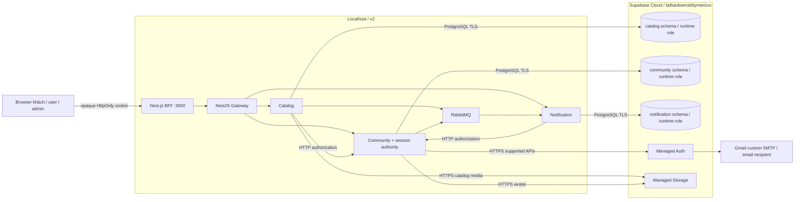
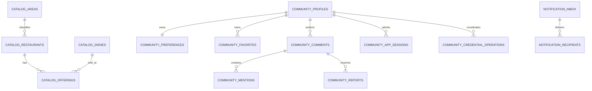

# GrabMeFood V2 — kiến trúc SCRUM-19

**Acceptance amendment S — owner-approved 2026-11-17:** supersedes historical
live Cloud closure gate64 below.64/21 keeps actual local scaffold/resource/
shutdown/persistence, offline safety guards and actual GitHub CI; formal live
Connect/network/chain+hostname/quota inventory belongs47/65, role creation22/
67–68, grants23/69, authenticated service-role TLS/isolation23/70. Keep DAG and
all before-demo security requirements; no remote mutation permission or role
proof from credential-free TLS.64/21 remain In Progress pending actual CI.
Current evidence/approval: [gate review](maintenance/SCRUM-64-gate-review.md).

**Status hiện tại: SCRUM-59/60 và parent SCRUM-19 đã Done theo approval riêng
của owner; budgets vẫn provisional, chưa runtime verification.** Gói C được giao
63→64 sau tiền nhiệm; scaffold63 đã build/start local, chưa business runtime.
Evidence: [SCRUM-63](maintenance/SCRUM-63-validation.md).
**Jira SCRUM-59: Done**, workflow transition đã thành công ngày2026-11-16 sau
final design gate verification và yêu cầu owner hoàn tất task.
Business source: [Spec Kit V2](../specs/003-grabmefood-v2/spec.md).
Technical research: [research.md](../specs/003-grabmefood-v2/research.md).
Scope: SCRUM-59 ranh giới/C4/ERD trước, SCRUM-60 contracts/ADR/plan/tasks/analyze sau.
Không có schema hoặc service V2 đã được tạo chỉ vì tài liệu này tồn tại.

## Phần nền đã được duyệt

- Next.js/TypeScript/Tailwind; NestJS Gateway + Catalog + Community + Notification.
- pnpm monorepo độc lập `v2/` theo lựa chọn A của chủ dự án.
- Supabase Cloud PostgreSQL/Auth/Storage, project `bdhavbwmxbttymerizvx`;
  web/services/RabbitMQ localhost và Docker Compose cho các thành phần local.
  Không yêu cầu Supabase Local, không K8s/Redis/Elasticsearch mặc định.
  [ADR-0001](adr/0001-supabase-cloud.md) ghi quyết định đã duyệt, không cấp quyền remote mutation.
- Mỗi business service có schema/DB role riêng; không business cross-schema
  reads/writes/joins/FK. Giao tiếp HTTP/events, frontend business traffic đi Gateway.
- Không reuse code/UI/assets/data legacy; root Vite giữ nguyên đến gói cleanup.

## C4 context và container — bản nháp ranh giới

Postgres Cloud có business schemas/roles tách biệt, không một role chung đọc mọi
schema. Auth/Storage internals do Supabase quản lý. Diagram là thiết kế, chưa có
runtime. Browser không ghi business DB hoặc nhận privileged keys/token Auth.
MCP là control-plane ngoài đường request ứng dụng, không là DB client runtime.
Policy repo chỉ cho 5 metadata reads. Sau đề nghị read/write ngày2026-11-16,
owner đã đồng ý giữ metadata-only cho SCRUM-59; MCP đã reconcile về V2 (xem dưới).

| Container | Ownership đã chốt trong roadmap | Không được sở hữu/làm |
| --- | --- | --- |
| Web | Render/BFF transport; UI system ở task UI sau | Business SQL, ORM domain, DB/privileged keys |
| Gateway | Routing/aggregation, trust boundary, JWT verification, request ID | Business tables hoặc bypass owner services |
| Catalog | Dishes/restaurants/offerings/categories/areas/media metadata/outbox | Community favorites/profile/comments hoặc inbox SQL |
| Community | Profiles/preferences/immutable handles/favorites/comments/replies/mentions/reports/outbox, app-session/revocation ledger, server-only token custody | Catalog content/prices hoặc inbox tables |
| Notification | Inbox/read state/broadcast, follow projection, processed events | Đọc favorites gốc hoặc sửa profile/preferences SQL |
| Supabase Auth/Storage | Managed identity primitives/object bytes và system schemas | Nơi để agents drop/write internals hoặc business cross-schema shortcuts |
| RabbitMQ | Event transport durable | Nguồn sự thật cho authorization hoặc bằng chứng consumer commit |

App-session authority/token custody trong Community và server-only BFF đã được
owner duyệt **A**. Không thêm service. Exact HTTP contracts/fields thuộc SCRUM-60.

## Trust boundaries và credential ownership — SCRUM-59

1. Browser → BFF: cookie opaque entropy cao, chỉ hash handle trong ledger;
   HttpOnly/SameSite, Secure khi HTTPS (localhost HTTP exception chỉ dev).
   Không browser Supabase JS/tokens/localStorage. Callback phải bind PKCE/state/
   purpose và allowlist return path; chống CSRF/origin trên mutation, no-store cho
   session/private responses. Không đưa code/token vào logs/analytics.
2. BFF → Gateway → owner service: không tin user/admin header từ browser;
   private actions có authorization đồng bộ Community, service identity được xác
   thực. Network localhost không tự là trusted; chặn direct business-service bypass.
   JWT nếu dùng làm identity credential phải kiểm signature/issuer/audience/expiry,
   không thay thế ledger. Service auth mechanics/timeouts chốt ở SCRUM-60.
3. Community → Auth: supported API, request-scoped client; normal app-session chỉ
   được admission sau password login thành công, không auto enroll từ JWT/refresh/
   verification/recovery callback. Recovery-only session không được private actions.
4. Durable revocation: logout chỉ session hiện tại; đổi/reset khóa admission,
   vô hiệu generation cũ, điều phối Auth update/global signout, yêu cầu fresh login.
   Refresh/admission phải serialize/recheck để không hồi sinh phiên. Partial failure
   lưu state phục hồi, fail-closed; session invalid 401, auth dependency unavailable
   503, không private side effect. Không positive authorization cache hoặc event async
   làm authority. Request được authorize trước revocation có thể hoàn tất.
5. Owner service → Cloud DB: credential runtime chỉ schema của mình, không owner/
   superuser/DDL mặc định, migration principal riêng và không nằm trong runtime
   containers. Không assume PostgreSQL role có `auth.uid()`. Mọi quyền user/admin
   kiểm ở backend. Không cross-service SQL/FK kể cả connection cùng engine.
6. Catalog/Community → Storage: metadata và quyền do owner service kiểm, object
   bytes do managed Storage. Không dùng private signed URL/JWT-only Data API làm
   đường bypass revocation. Bucket/path/MIME/size/public-media policy và upload
   transport chi tiết thuộc contracts/Storage tasks; chưa phê duyệt direct upload.
7. Cloud/network/broker: TLS xác thực certificate, không disable verification.
   Secrets tách env local theo service ngoài Git; không in DSN. RabbitMQ nội bộ,
   ack sau commit/idempotency, không coi publisher confirm là consumer commit.
   Outage không được giả successful write hoặc empty result.

## Schema/ERD boundary tối thiểu

Các tên trên là domain nodes để thấy quan hệ **nội bộ**, không phải migration
đã triển khai. Comment có target type/UUID và parent cùng target, tối đa một tầng.
External user/catalog IDs trong service khác chỉ là stable references; không tạo
FK vào schema service khác hoặc `auth.users`.
Session/revocation/credential-operation records chỉ trong Community. Catalog
media và Community avatar metadata có object reference, không FK Storage internals.
Outbox nằm trong schema producer; Notification tự sở hữu follow projection,
processed events, recipients/read states; không query favorites/preferences gốc.

Data dictionary, indexes, exact constraints và quyền runtime/migration sẽ được
đối chiếu thành `data-model.md`/contracts sau khi ranh giới đã rõ; không tự coi
ERD tối thiểu này là toàn bộ schema V2.

## Localhost resource budget — owner duyệt provisional, chưa đo runtime

Snapshot lịch sử59: 15.71 GiB RAM, free khoảng 4.98 GiB lúc kiểm; 20 CPU logic;
C free 17.76 GiB, D free 61.25 GiB. Docker Engine chưa được xác minh, WSL chưa cài.
Update64: owner bật Desktop; actual version/info xác nhận Engine29.9.3 chạy Linux/
WSL2, VM7.609GiB capacity. Owner sau đó xác nhận Docker data trên C tại
`C:\Users\HUY\AppData\Local\Docker\wsl` và duyệt2image pins. Resource recheck:
hostfree≈3.22–3.83GiB<6, Cfree≈12.947GiB<15; không full-stack PASS.
Profile `demo-lite` (declared container caps2GiB/runtime-only guard4GiB/build
guard6GiB) **đã được owner duyệt tiếp theo**, preflight explicit profile/phase
đã hỗ trợ; chưa Compose enforcement/runtime measurement. Không override disk15GiB.
Xem [evidence64](maintenance/SCRUM-64-validation.md).
Update tiếp64: owner tự chuyển data bằng Desktop sang `D:\DockerDesktopWSL`;
folder/VHD metadata và Engine đã kiểm, diskD≈59.129GiB PASS≥15. Windows/temp
vẫnC≈14.82–14.84GiB, build contextD; không áp guard Docker15 lên C nữa.
RAM lúc recheck≈2.79–2.81GiB khiến cả runtime4/build6 bị chặn, không overall PASS.
Preflight đã dùng explicit path, không hardcode C; không đổi guard/code để bỏ qua.

Cloud-adjusted guard đã duyệt provisional trước full stack: RAM hữu dụng >=15 GiB, RAM trống
>=6 GiB; ít nhất 15 GiB trống tại Docker data và 10 GiB nơi workspace.
Không tự đóng ứng dụng, đổi VHD location hoặc chỉnh WSL để đạt guard.

| Nhóm runtime | Budget RAM dự kiến (MiB) |
| --- | ---: |
| Next.js production web | 384 |
| Gateway | 256 |
| Catalog / Community / Notification | 384 mỗi service |
| RabbitMQ | 512 |
| Postgres / Auth / Storage / Studio / SMTP inbox local | 0 — không chạy trong topology mặc định |
| Tổng services local ước tính | 2304 |

Thêm overhead VM/runtime và build: mục tiêu local steady-state <=4 GiB,
build tuần tự, peak khoảng 6 GiB. Đây là **target**, không phải `docker stats`
đã đo. Dev/hot reload/E2E có thể cần thêm; phải đo trước khi pin container limits.
Nếu vượt budget: đo/review cách tuning, không tự bỏ service hoặc đổi stack.

### Approved alternative — demo-lite tại64

Owner: “Tôi duyệt profile trên và nhớ bổ sung trên jira để đồng bộ”.
Giữ đủ6containers/Cloud/DB pools4/4/2; production, không watch/HMR, build tuần tự
tách khỏi runtime. Web512/Gateway256/Catalog256/Community256/Notification256/
RabbitMQ512MiB, tổng hard caps đề nghị thực thi2048MiB. Approved targets chưa
runtime measurement/enforcement; không capacity/OOM-free guarantee.
Default/full/build vẫn freeRAM≥6GiB; chỉ explicit demo-lite runtime≥4GiB,
Engine phải reachable/Linux. Mọi profile giữ usableRAM15/Docker-data15/workspace10.
Không dùng approval này để kill/prune/delete/đổi WSL hoặc mutate Cloud.
Record: `v2/infra/demo-lite.json`; chưa chuyển64/21 Done.

### Resource-budget amendment64 — owner cho phép đánh giá/điều chỉnh và chạy đo

Budget6GiB trước là conservative planning target, không Docker/Node/service
minimum chung. Owner đã cho sửa local Compose/scripts/preflight theo budget
measured và giữ safety/acceptance, không đổi pins/architecture/WSL global.
Demo-lite mới: build **single capped Linux container2048MiB, no swap**, Node
old-space768MiB/Next cpus1; các runtime caps6services giữ tổng2048MiB. Default/
unbounded fallback không được tự áp budget này.

Idle5samples: Windows available min5.678GiB, WSL WS≈960.62MiB (capacityVM7.61
không resident). Pilot build memory.peak1537.85MiB, sampled maxVMWS3649.27MiB,
minWindowsavailable2825.84MiB, noOOM/restarts0. Residual VMdelta−cgrouppeak≈
1150.8MiB →planning allowance1280MiB. Không coi noncoincident peaks là exact
physical decomposition; baselineWSL không đếm thêm vào available requirement.
Budgetphase =2048workloadcap+1280incrementalallowance+1024hostreserve
=4352MiB=**4.25GiB available**, build/runtime tách nhau. Disk guards giữ15/10.
Runtime allowance tạm dùng mức conservative đã thấy trong build, chưa được
full-stack validation. Swap không được tính/containers không thêm swap.

Pilot thất bại do pnpm packaging/nonTTY; fixes có regression tests nhưng rerun
bị guard chặn do available1.24–1.59GiB khi host load thay đổi. Chưa Docker runtime/
Cloud/CI PASS,64/21 chưa Done. Không WSL limit/settings change, kill/delete/prune.

Latest64 runtime evidence: cached retry sửa actual packaging-dir collision,
Linux build/package exit0,5/5runtime images built. Fresh test project6containers
healthy đồng thời60s, HTTP200/503/404, stop/start và durable broker message PASS;
OOMfalse/restarts0, cgroup caps/noSwap inspected. MinWindowsavailable4964.42MiB/
maxVMWS2993.07MiB, no reserve breach. Sau test đúng project đã stop, data giữ.
Đây là local scaffold only, không business/Cloud/CI/full-workload capacity.
Task64/21 chưa Done; [runtime evidence](maintenance/SCRUM-64-runtime-validation.md).

Số đo cũ C/D có thể đáp ứng disk guard mới nhưng free RAM cũ 4.98 GiB chưa đạt
guard 6 GiB; cần đo lại ở SCRUM-64. Data location cần chủ máy chọn/chấp thuận.
Đây là gate của SCRUM-64, không phải quyền reset hoặc di chuyển volumes.

## Cloud preflight và DB connection budget

- Direct metadata owner cung cấp ngày 2026-11-16, không suy từ ref:
  host `db.bdhavbwmxbttymerizvx.supabase.co`, port `5432`, database `postgres`,
  user `postgres`. User này là thông tin kết nối quản trị, **không phải** runtime
  credential chung. Runtime roles riêng chưa tạo, tên/password/grants chưa chốt.
  Session-pooler endpoint chưa được cung cấp; không tự ghép host/user.
- Candidate pool cap (chưa pin config): Catalog 4, Community 4, Notification 2;
  tổng 10 runtime connections cho một replica/service; Gateway/Web không có DB pool.
  Background jobs dùng cùng cap; migration tối đa 1 riêng khi được duyệt. Giới hạn
  ordinary lý thuyết57 theo owner SQL report bên dưới, không phải quota dành riêng
  cho app. Phải tính other usage và operational headroom riêng trước khi chốt;
  nhân replica phải tính lại. Không coi 11 là capacity đã nghiệm thu.
- Kiểm IPv4/IPv6 và driver/session pooler compatibility, TLS CA/hostname, timeout,
  backoff có giới hạn, không retry mù write không idempotent. Không tự chọn
  transaction pooler hoặc tắt TLS để hết lỗi.
- Kiểm project active/not paused, network/DNS, pool saturation, Storage/egress/Auth
  quotas và email provider limits trước demo. Không đổi plan/restore project tự động.
- Site URL mong muốn `http://localhost:3000`, callback `/auth/callback`, reset UI
  `/auth/reset-password`; allowlist exact URLs, không wildcard rộng. Callback nhận
  code và phân biệt verification/recovery trước khi route reset; reset page không
  tự cấp normal app-session. Không giả rằng chỉ thêm reset page URL là đủ PKCE.
- Gmail SMTP owner đã cấu hình Dashboard, chưa kiểm send. Test sau scaffold:
  hai mailbox owner kiểm soát → signup → email verify → fresh login → forgot
  password → recovery-only callback → update → mọi phiên cũ bị chặn → fresh login.
  Kiểm expired/reused/mismatched callback, enumeration-safe errors, SMTP failure/
  rate limit có retry guidance, không auto resend loop. Không log token/email riêng.
- `opencode mcp list` ban đầu needs authentication, sau đó **connected**.
  Supported read-only MCP trả API URL `https://bdhavbwmxbttymerizvx.supabase.co`;
  `list_tables` cho public/catalog/community/notification trả `tables=[]`,
  `list_migrations` trả `migrations=[]`. Đây là metadata evidence, không chứng minh
  mọi schema/Auth users/Storage đều rỗng hoặc NestJS PostgreSQL kết nối được.
  Chưa kiểm Auth Dashboard URL settings, Storage, plan hoặc email delivery;
  direct Connect/SSL metadata đã được owner bổ sung bên dưới.

### Connection capacity worksheet — 2026-11-16, approved provisional/chưa triển khai

| Input | Giá trị / provenance |
| --- | --- |
| Compute | Nano — owner xác nhận Dashboard, không suy ra plan |
| Server-side pool size | 15 mỗi cặp user/database — owner xác nhận |
| Max pooler client connections | 200 — owner xác nhận, không phải PostgreSQL max_connections |
| PostgreSQL max_connections | 60 — owner chạy SQL chỉ đọc và cung cấp kết quả, AI chưa kiểm độc lập |
| superuser_reserved_connections / reserved_connections | 3 / 0 — cùng owner SQL report |
| Ordinary ceiling lý thuyết | 60−3−0=57; không phải app allocation |
| Plan / peak managed-services usage / clients khác | Chưa biết; snapshots5 và8 không phải peak |
| SSL enforcement | Owner xác nhận đã bật; chưa query kiểm độc lập |
| CA | Owner đã tải; file local `C:\Users\HUY\Downloads\prod-ca-2021.crt`, chưa đọc/kiểm |

**Một process mỗi service**, một pool duy nhất dùng chung cho requests, health
checks, outbox/consumer/background jobs của service đó:

| Process | App pool cap đề xuất | PostgreSQL backend cap bảo thủ |
| --- | ---: | ---: |
| Web / Gateway / RabbitMQ | 0 | 0 |
| Catalog | 4 | 4 |
| Community (kể cả auth/session ledger) | 4 | 4 |
| Notification (kể cả consumer/polling) | 2 | 2 |
| Runtime tổng | 10 | 10 |
| Migration runner riêng, tối đa một lần chạy | 1 | 1 |
| Runtime + migration nếu trùng thời gian | 11 | 11 |

- **Direct**: 10 app connections có thể chiếm 10 PostgreSQL backends; pooler
  settings 15/200 không giới hạn hoặc chứng minh capacity cho đường direct.
- **Session pooler nếu cần IPv4**: giữ nguyên role riêng, cùng các app caps.
  Với một process/role, lần lượt 4≤15, 4≤15, 2≤15. Nếu migration đi pooler, role
  riêng 1≤15; endpoint/role support phải kiểm thật trước chọn. Không cộng thành
  "10≤15 nên toàn DB an toàn". Ba pool service có theoretical server-side ceiling
  3×15=45 (chưa tính migration/clients khác); app caps chủ động mới giới hạn về 10.
  Nếu dùng nhiều pooler/mode đồng thời, phải cộng tất cả backends, không reuse
  headroom hoặc đếm 200 như số DB sessions khả dụng.
- Client-side: nếu chỉ ba services đi shared pooler, dự toán 10 clients; thêm
  migration qua cùng pooler là 11. Phần còn lại của 200 chưa phải capacity được
  cấp cho app vì có thể còn clients khác và backend limit thấp hơn. Session mode
  giữ backend theo session, không bảo đảm multiplex nhiều idle clients như
  transaction mode.
- Formula scale/rollout: `P = 4*rCatalog + 4*rCommunity + 2*rNotification + m`,
  với `m∈{0,1}`. Một replica mỗi service → P=10 hoặc 11; chạy đồng thời hai bộ
  processes → P=20 hoặc 21, không nằm trong demo budget một bộ. HMR/test workers/
  scripts không được tự tạo thêm pool ngoài caps; release client trong finally,
  đóng pool khi shutdown, không giữ DB transaction qua HTTP/Auth/RabbitMQ wait.
- Gate ordinary connections: **`P + U + H ≤ 57`**, không gồm3 reserved slots.
  P là app runtime+migration backends, U là other backend usage ngoài P, H chỉ
  operational headroom. Definitions/proposal/evidence bên dưới; U_peak chưa biết,
  H=12 đã được owner duyệt provisional; U_peak chưa đo → **chưa PASS aggregate capacity**. Không tự đổi pool size,
  compute, max clients hoặc plan.

### Capacity evidence owner bổ sung — không phải AI independent verification

Nguồn là owner chạy SQL read-only và chụp Dashboard, sau đó cung cấp tóm tắt
trong hội thoại ngày2026-11-16. AI chưa chạy lại SQL, chưa đọc raw SQL/screenshot
hoặc kiểm độc lập. Không tự gán timestamp thu thập/sampling interval chưa có.

**SQL snapshot**: max_connections60, superuser_reserved_connections3,
reserved_connections0, current_client_connections5 tại lúc query.

| Role | State | Connections tại SQL snapshot |
| --- | --- | ---: |
| authenticator | idle | 1 |
| pgbouncer | idle | 1 |
| postgres | active | 1 |
| supabase_admin | idle | 1 |
| supabase_storage_admin | idle | 1 |
| Tổng | | 5 |

`postgres active` có thể là query quan sát từ SQL Editor; chưa đủ bằng chứng để
tự loại nó khỏi count. Role privileged không đồng nghĩa đang dùng reserved slot;
không trừ tiếp các sessions đó chỉ vì đã loại3 slots khỏi ceiling.

**Dashboard snapshot khác**: Connections8/60; active queries0; idle in
transaction0; blocked queries0; top blocker/longest running không hiển thị.
Sessions đang lọc3 roles anon/authenticated/postgres, nên “No active sessions”
không nói toàn DB không có kết nối. Không dùng5 và8 như cùng thời điểm, không
gọi chúng mâu thuẫn hoặc lấy8 làm peak. Active queries0 không có nghĩa connections0.

### Headroom và review budget — owner duyệt provisional, không capacity PASS

Giữ cap P=10 runtime (4+4+2), migration tối đa1 khi có approval, worst-case P=11.
Owner duyệt provisional **H=12 operational slots**, xấp xỉ21% ceiling ordinary57, **ngoài**3
superuser reserved slots đã trừ. Lý do: giữ buffer cho dao động ngoài các cửa sổ
đo, reconnect/startup/monitoring và thời gian xử lý khi sát trần. Đây là lựa chọn
thận trọng để review trên Nano khi chưa biết U_peak, không phải Supabase requirement
hoặc số liệu đã đo. Không cấp buffer này cho app pool/replica bổ sung.

- U bao gồm PostgreSQL backends managed Auth/Storage/PostgREST, pooler backends/
  clients khác, admin/SQL Editor, monitoring và diagnostics **chưa nằm trong P**.
  Đếm mỗi backend/session một lần; không cộng pooler front-end client vào cùng
  backend lần nữa. Không tính lại app/migration sessions đã thuộc P.
- H không là measured usage, không gồm3 reserved slots, không cộng lại một
  managed-service allocation đã tính trong U. Phần tăng chưa quan sát có thể
  tạm dùng buffer; khi trở thành sustained usage phải đưa vào U và tính lại.
- Ràng buộc với H=12 (approved provisional):

| Scenario | P | U tối đa theo bất đẳng thức, không phải measured peak |
| --- | ---: | ---: |
| Một process/service, runtime | 10 | 57−10−12=35 |
| Runtime + một migration đã được duyệt | 11 | 57−11−12=34 |

Vì thế **`11 + U_peak + 12 ≤ 57` yêu cầu `U_peak ≤ 34`**. Đây chỉ là
điều kiện kiểm khi peak usage có evidence; H đã duyệt provisional, cần re-review
nếu số đo/thông số/workload thay đổi. Không thế5/8
snapshot vào U_peak để tuyên bố PASS; không gọi34 là U thực tế hoặc quota được
Cloud cấp. Phần3 slots superuser không là overflow budget cho ứng dụng.

**Review outcome**: cap4/4/2 và H12 được owner duyệt provisional có điều kiện, chưa pin/apply.
Đã biết ceiling theo owner report; còn thiếu plan, U_peak theo thời gian khi
đầy đủ apps/broker/Auth/Storage chạy để kiểm/review lại H=12. Giới hạn kết nối không
chứng minh Nano đủ CPU/RAM/latency; resource/workload evidence vẫn phải có.

**Evidence kế tiếp, không thực thi SQL ở SCRUM-59**: ở task kiểm thử/hạ tầng được
giao sau này, thu time series có timestamp, sampling interval/window và workload:
idle baseline, startup, concurrent journeys/Auth/Storage, polling/consumers,
reconnect/shutdown; migration đồng thời chỉ nếu được duyệt. Phân biệt P_actual/
U_actual bằng app/service role + application_name/connection identity, không lấy
total rồi cộng app lần nữa. Kiểm pool waiting/acquisition timeout và leak/idle
transaction, review peak/headroom với owner; không thu raw query/secret/PII không
cần thiết. Nếu vượt envelope, dừng review/tune proposal, không tự đổi Cloud plan.

### TLS, connectivity và credential gate

- Yêu cầu owner: client xác minh **certificate chain và hostname** bằng
  `verify-full` hoặc tương đương driver. SSL enforcement chỉ từ chối plaintext,
  không thay client-side identity verification. Không `rejectUnauthorized=false`,
  không `NODE_TLS_REJECT_UNAUTHORIZED=0`, không chỉ `sslmode=require`.
- CA file local hiện chỉ do owner báo đường dẫn, không được embed absolute path
  làm prerequisite portable của repo. Task infrastructure sau sẽ dùng đường dẫn
  env server-only và read-only mount trong container; không commit password,
  private keys hoặc copy CA vào bundle. Cần kiểm PEM/expiry/fingerprint/provenance
  trước sử dụng; chưa có kết quả certificate verification ở lượt này.
- Với candidate driver `pg`, phải dùng một nguồn cấu hình TLS rõ ràng để DSN
  parser không ghi đè CA/verification; kiểm hostname against Connect host và
  test wrong CA/hostname rejection tại task hạ tầng, không triển khai driver ở đây.
- Credential quản trị chỉ cho workflow đã duyệt; không copy DSN `postgres` vào
  tất cả services. Password nếu đưa vào URI phải percent-encode **password
  component**, không encode cả URI hoặc log URI thật. Không yêu cầu secret chat.
- Thực chạy từ Windows host: `Resolve-DnsName ... -Type AAAA -DnsOnly` trả AAAA;
  `Test-NetConnection ... -Port 5432` báo name resolution failed,
  `TcpTestSucceeded=False`, `RemotePort=0`. Không tới TCP/TLS/Auth, không chứng minh
  port đóng hoặc project down. DNS AAAA không chứng minh usable IPv6 route từ
  Windows/Docker. Cần kiểm đường mạng usable trước chọn direct; nếu IPv4-only,
  owner cung cấp Session pooler Connect metadata không bí mật. Không mua IPv4 add-on.
- Không đọc certificate ngoài repo, không đọc password/env, không connect
  PostgreSQL hoặc chạy SQL bằng MCP trong lượt này.

### MCP đã reconcile; yêu cầu reset không thực thi trong SCRUM-59

Owner từng báo đã cấp MCP read/write và cho phép không dùng isolated target. Kiểm file
trước phê duyệt tiếp theo thấy `mcp.supabase`, URL rộng không `read_only=true`, `enabled=true`;
đồng thời `permissions` vẫn deny `supabase_*` trừ 5 metadata tools. Đây là user
change, đã giữ nguyên để hỏi owner. Lúc đó `npm test`
45 pass/2 fail do guardrail expectation `mcp.servers`/read-only. Không đổi tests
để che mismatch, không qua shell/SQL/agent khác để vượt deny.

Owner tiếp theo trả lời “đồng ý và nhớ cập nhật lại jira nếu có hay đổi cần sự
đồng bọ”, chấp thuận riêng chuẩn hóa MCP V2 và giữ metadata-only cho SCRUM-59.
Chỉ khối MCP trong repo đã đổi thành `mcp.servers.supabase`, project ref cố định
`bdhavbwmxbttymerizvx`, `read_only=true`, features docs/database/development.
Permissions/policies/canary/tests không đổi; arbitrary SQL/mutations/key retrieval
vẫn deny. Sau sửa `npm test` PASS47/47, typecheck0/66, structure73/73;
`opencode mcp list` connected. Đây không là PostgreSQL/TLS/SMTP application test.

Quyền tool read/write không tự giao migration/seed/reset hoặc task tương lai.
Exception bỏ isolated test target còn xung đột constitution/AGENTS/ADR; trước
destructive execution cần review amendment và trình exact target/allowlist/impact/
backup status, chờ owner xác nhận riêng. SCRUM-59 hiện không cần destructive
operation nào; **không đưa ra reset allowlist hoặc thực thi reset trong task này**.

## Gate

- SCRUM-59: owner đã duyệt Gói A review boundaries/session, provisional budgets và
  phân chia design/runtime acceptance bên dưới. Gate thiết kế được đối chiếu bằng
  artifacts/static checks; không đòi full-workload trước scaffold hoặc miễn test.
  SCRUM-59 đã Done sau final gate verification theo yêu cầu owner; không chuyển
  parent19 hoặc bắt đầu60.
- SCRUM-60: chưa tạo full contracts/data-model/plan/tasks/analyze; template còn rỗng.
  Ngoại lệ: ADR Cloud đã tạo theo yêu cầu chuyển đổi, không làm toàn SCRUM-60.
- SCRUM-63/64: chưa scaffold/install dependencies/start Docker; chưa được giao
  execution, full contracts/plan/prerequisites và approval thao tác vẫn phải đạt.
- Không migrations/seed/reset/config remote/UI/full Auth. Rebuild/restore blocked
  vì chưa có isolated approved target; không thử trên project chính.

## Tiến độ thực tế

Trước approval Gói A ngày2026-11-16: khoảng **70% SCRUM-59** theo ước tính khối lượng, không phải % Jira
hay tỷ lệ acceptance. Đã giữ và bổ sung C4/ERD boundaries, ownership, session A,
trust và Cloud/local resource proposal. Ở mốc đó còn thiếu review/acceptance.
Direct Connect/SSL và max_connections60/reserved3/ordinary57 đã có owner evidence;
các mục U_peak, plan, network/TLS/app/resource evidence là follow-ups runtime sau
scaffold theo acceptance split đã duyệt. H12/pool/resource targets được duyệt
provisional, không phải capacity/runtime PASS.
Blocker thiếu giới hạn DB đã được gỡ ở mức owner report, không phải aggregate
capacity PASS. Không tự cập nhật progress field hoặc chuyển task; estimate cũ
không thay thế bảng đối chiếu gate thiết kế sau approval.
Không chuyển SCRUM-60; không lấy baseline legacy tests làm bằng chứng V2 runtime.

## Gói A — review SCRUM-59 và approval owner

Review này đối chiếu current SCRUM-59/task cha19, descriptions/amendments và
comments mới nhất đã đọc, approved spec/ADR, research/validation và repo thực tế.
Review ban đầu trình proposals, không tự sửa acceptance trước owner approval.
Owner sau đó xác nhận **“tôi duyệt các đề xuất”** trong hội thoại ngày2026-11-16:
duyệt phần review thiết kế/assumptions, provisional budgets và acceptance split.
Không suy ra permission remote hoặc acceptance runtime thành công.
Spec Kit1.3.3/OpenCode-PowerShell đã kiểm metadata/instructions; reuse artifacts,
không chạy lại specify/plan/tasks/analyze hoặc tạo spec nghiệp vụ song song.

### Review tính nhất quán — đã đối chiếu ở mức thiết kế

| Boundary | Kết quả review | Chưa được coi là đã kiểm runtime |
| --- | --- | --- |
| Service/data ownership | Catalog content/offerings/media; Community profiles/preferences/saved/comments/session ledger; Notification inbox/read/projection. Schema/role riêng, HTTP/events thay business cross-schema SQL/FK | Roles/grants/constraints chưa tạo, ERD hiện là conceptual boundary |
| Browser/BFF/Gateway | Opaque HttpOnly cookie, tokens server-side; frontend business APIs qua Gateway; không shared runtime postgres/admin credential | Chưa có browser/BFF/API implementation để kiểm CSRF/cookies/token leaks |
| Session/revocation | Khớp ADR session A: Community authority, fail-closed sync check, không JWT-only/positive cache/broker authority; normal login admission khác recovery-only | Chưa có logout/password/reset/refresh races hoặc partial-failure tests |
| Revocation timing | Chặn authorization mới sau durable point; request authorized trước đó có thể hoàn tất. Không tự đổi thành cancel in-flight | Cần integration/fault tests sau implementation |
| Identity và quyền | Không tin browser identity header; backend authz không assume auth.uid(); không direct private Storage/Data API bypass | Service auth details/contracts ở60; negative tests sau schema/services |
| Cloud/local | Cloud DB/Auth/Storage, local apps/broker; TLS chain+hostname, không startup migration/seed/reset | MCP connected/DNS AAAA không chứng minh PostgreSQL/TLS/Auth/SMTP thành công |

Không thấy lý do phải đổi các ranh giới hoặc session A đã duyệt. Những chi tiết
HTTP/event payloads, service-auth/timeouts, schema dictionary đầy đủ vẫn thuộc60,
không được biến review59 thành triển khai contracts/scaffold/Auth application.

### Phân loại evidence và assumption

| Loại | Đầu vào hiện có | Giới hạn |
| --- | --- | --- |
| AI static checks | Current root package vẫn legacy; glob không có v2; baseline tests47/47, typecheck0/66, structure73/73 | Không là test runtime V2 hoặc proof Cloud |
| AI tool observations đã ghi lịch sử | MCP metadata API URL/tables/migrations; DNS AAAA có nhưng host TCP probe không tới kết nối | Không chạy lại hoặc nâng thành successful DB/TLS verification ở review này |
| Owner report | Direct Connect; SSL enforcement/CA đã tải; Nano/pool15/clients200; SQL60/3/0/57 và snapshots5/8; Gmail SMTP | AI chưa kiểm độc lập DB settings/CA/SMTP/SQL screenshot |
| Approved provisional | Caps4/4/2, migration1 khi được duyệt riêng, H=12; local RAM/disk/startup guard targets | Owner duyệt Gói A; chưa pin/configure hoặc measured |
| Chưa có evidence | Plan, usable app network/TLS, U_peak/time series full workload, measured RAM/CPU/latency, redirects/email/Auth E2E | Không PASS; phải có task/runtime phù hợp để kiểm |

### Dependency acceptance cần owner duyệt trước khi chỉnh

Current SCRUM-59 có mục tiêu C4/ERD/ownership/trust nhưng kế thừa câu “dữ liệu có
constraints/permissions tests”; các amendment còn liệt kê U_peak/app TLS thiếu.
Trong khi đó repo chưa scaffold V2, schema/services chưa có; parent19 còn gồm
contracts/plan/tasks/analyze thuộc subtask60 sau59. Nếu buộc59 có tất cả runtime
evidence của hệ thống đầy đủ trước scaffold, tạo dependency vòng.

**Phân chia được owner duyệt trong Gói A để đồng bộ acceptance Jira:**

| Gate | Phạm vi đề xuất | Evidence vẫn bắt buộc, không được miễn |
| --- | --- | --- |
| SCRUM-59 | Review C4/conceptual ERD/ownership/session A, provenance/assumptions/risk; owner chốt provisional budgets và đường kết nối dự kiến | Owner approval review + budgets; test design obligations và runtime follow-ups được định danh, không báo runtime/capacity PASS |
| SCRUM-64 sau scaffold | Cloud/local preflight, resource/readiness, connectivity và certificate/hostname verification từ môi trường chạy | Smoke positive/negative TLS theo quyền và credentials được cấp riêng; không buộc full feature workload ở đây |
| SCRUM-70 sau schema/grants; SCRUM-112 audit | Service/user isolation, RLS/backend authz, secret/internal-auth/Storage negative tests | Evidence thật, không thay bằng conceptual ERD |
| SCRUM-107/108 sau features | Journeys/session revocation, recovery-only, concurrency/outage/partial failure | Test theo ADR/FR-031, không JWT-only fallback |
| SCRUM-111 khi full workload sẵn | Peak other usage, pools/waits/leaks, RAM/CPU/latency và headroom review | Time series/window/workload tách P/U; aggregate capacity gate, không dùng5/8 làm peak |

Đã đọc current scopes các tasks được dẫn trên. Sau owner approval, bảng là phân
chia acceptance được duyệt để đồng bộ Jira; không giao thực hiện, không tự đổi
dependencies/status hoặc chuyển task.
Network TLS cần credentials/role/target chưa có ở64 thì phải báo blocked và
owner điều phối prerequisite, không giả bootstrap/reset đã được cấp quyền.

### Quyết định Gói A đã được owner duyệt — không mở lại session A

- Chấp thuận provisional pool caps4/4/2, migration1 khi được duyệt riêng,
  H=12 ngoài3 reserved; cùng local resource targets ở section budget. Chấp thuận
  provisional không pin settings, cấp migration hoặc chứng minh capacity PASS.
- Chấp thuận phân chia design acceptance59 và runtime validation sau scaffold
  ở bảng trên. AC đã đồng bộ;59 đã Done sau final verification, không chuyển60.
- Owner cung cấp plan và Session pooler Connect metadata không bí mật nếu chọn
  fallback. Direct chưa chứng minh usable; không khẳng định chắc chắn không dùng
  được ở mọi mạng. Không tự ghép endpoint hoặc giảm certificate verification.

### Đối chiếu gate thiết kế SCRUM-59 sau approval

| Acceptance thiết kế được duyệt | Evidence / trạng thái |
| --- | --- |
| C4/conceptual ERD/ownership/trust nhất quán Cloud + local | Các section tương ứng ở file này, khớp spec/ADR; review tài liệu đã đạt |
| Session A và ranh giới authority/revocation giữ nguyên | ADR Accepted và review matrix; không browser token/JWT-only; review đã đạt |
| Provenance/assumptions/risk/connection strategy minh bạch | Owner reports và AI observations tách biệt; direct chỉ dùng nếu usable, Session pooler metadata là prerequisite fallback; không claim TLS PASS |
| Provisional DB và local resource budgets có owner quyết định | Caps4/4/2, migration1 khi duyệt riêng, H12 và local targets: approved provisional; chưa pin hoặc measured |
| Runtime checks có acceptance follow-up, không bị miễn |64 preflight/TLS/resource,70 isolation,107/108 journeys/fault,111 workload/capacity,112 audit; đã duyệt phân chia, chưa thực thi |

Plan, session-pooler endpoint và runtime evidence chưa có vẫn phải ghi thiếu.
Chúng không bị biến thành “đã đạt” để đóng gate; đã được phân loại vào runtime/
preflight follow-ups sau scaffold thay vì dependency vòng trước scaffold.

### Chốt SCRUM-59

Owner yêu cầu “tiếp tục cho xong đi chứ”; đã kiểm final5/5 design acceptance
và checks, Jira workflow `transitionId=41` trả `statusName=Done`.
Không giữ In Progress chỉ vì đang bàn giao. Estimate70% ở các snapshot trước
không là tiến độ hiện tại: phần thiết kế59 đã hoàn tất theo acceptance được duyệt.
SCRUM-19 vẫn còn60; chưa thực hiện60, scaffold hoặc runtime verification.

## SCRUM-60 — contracts/planning sau approval

Owner giao riêng60 sau59 Done, duyệt6 đề xuất và Community receipt linearization
tại [ADR-0002](adr/0002-v2-contracts.md). Các câu “chưa60/template” phía trên là
snapshot trước assignment này, không trạng thái hiện tại.
[Plan](../specs/003-grabmefood-v2/plan.md),
[data dictionary](../specs/003-grabmefood-v2/data-model.md),
[HTTP/session/events](../specs/003-grabmefood-v2/contracts/README.md),
[task trace](../specs/003-grabmefood-v2/traceability.md) đã qua remediation và
analyze read-only; owner đã nghiệm thu tài liệu và Jira SCRUM-60 đã Done.
Không scaffold/app/schema được tạo. Token/session authority vẫn Community;
recipient receipt cũng Community, inbox/read/import Notification; projection
không là recipient authority. Diagram session/delivery bổ sung trong artifacts.
Runtime gates/budgets/no implicit provisioning giữ nguyên, không capacity PASS.

### Bàn giao nghiệm thu SCRUM-60 — owner đã duyệt và Jira Done

Đối chiếu current AC60 và phần kế thừa từ19 đã hoàn tất ở mức tài liệu:
HTTP/events/pagination/errors/auth/retention/replay, data dictionary/diagrams/
ownership, ADR được duyệt, plan/tasks/analyze và requirements trace đều có
artifact/evidence thật. Bảng đầy đủ và kết quả checks tại
[validation — đối chiếu toàn bộ AC](../specs/003-grabmefood-v2/validation.md#scrum-60--đối-chiếu-toàn-bộ-ac-để-trình-owner-nghiệm-thu).
Analyze sau remediation không phát hiện findings còn lại trong vòng review;
report hội thoại/Jira60 comment10033. Approval remediation không là approval Done;
owner sau đó đã **nghiệm thu riêng60 và cho phép chuyển riêng60 sang Done**.

Không đòi UI render/schema permission tests hoặc Cloud full-workload chưa tồn tại
để đóng task tài liệu. Những obligations64/70/81/82/88/103/104/107/108/111/112
và75/76 vẫn chưa chạy, không bị miễn và không nâng thành PASS. Chưa có scaffold.
SCRUM-60 Done bằng workflow transition41 đã trả statusName=Done; SCRUM-19 giữ
In Progress để review/owner chốt task cha riêng, không tự Done do60 hoàn tất.
Dependency Jira hiện tại:21 bị chặn bởi6 (Done) và19 (In Progress). Đề xuất63
(subtask đầu21, rồi64) **sau** gate60/19 được nghiệm thu và owner giao scope mới;
không triển khai hoặc đổi dependencies ở lượt bàn giao.

### Review riêng task cha SCRUM-19 sau closure60

Đã kiểm current AC19 độc lập với trạng thái con: predecessor18 Done;59 đạt
5/5 design gate/owner approval và Done;60 đủ AC/document evidence/owner approval
và Done. C4/ERD/ownership/trust ở59 khớp dictionary/HTTP/auth/events/ADR/plan ở60;
31FR+7SC→64 task paths/Jira/analyze; resources/provenance/provisional budgets và
no K8s/Redis/Elastic được ghi. Baseline/static validators đã chạy thật.
Review matrix đầy đủ tại [validation](../specs/003-grabmefood-v2/validation.md#chốt-scrum-60-và-review-riêng-scrum-19).

Không xác định còn thiếu evidence trong **AC thiết kế của19** qua lượt review;
đủ trình owner nghiệm thu parent, nhưng chưa được phép tự transition19.
Runtime64/70/81/82/107/108/111/112 và rebuild75/76 giữ nguyên, không trở thành
pre-scaffold evidence để giữ19 mở. Blocker hiện tại của63 là gate nghiệm thu19
chưa chốt, không phải60 chưa Done hay thiếu runtime Auth/Cloud trong task thiết kế.
Gói C đã được nêu với điều kiện sau predecessors, không bỏ gate19:
chưa scaffold/install/start Docker/Cloud probes hoặc tạo CI ở lượt này.
