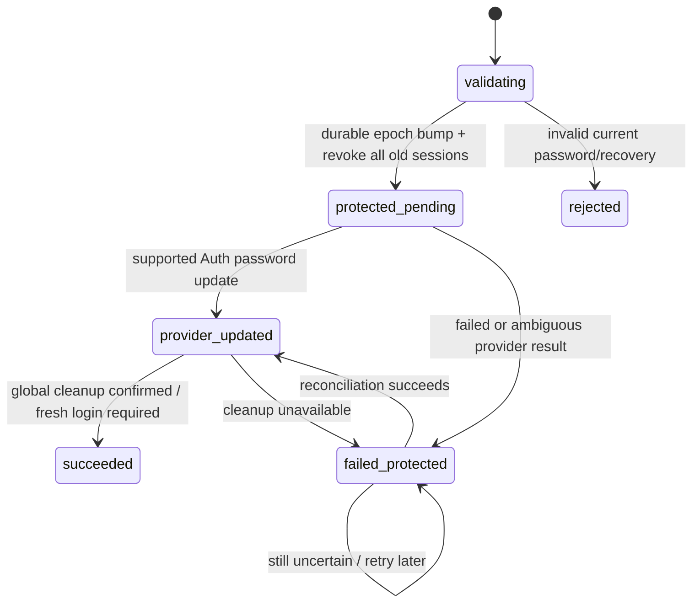

# Authorization/session A — normative protocol

[ADR-0001](../../../docs/adr/0001-supabase-cloud.md) giữ authority.
[ADR-0002](../../../docs/adr/0002-v2-contracts.md) thêm deadlines được duyệt.
Cloud Auth là identity/password provider; Community là app-session authority.

## Service trust

- Browser không gọi owner services trực tiếp, không user/admin/internal headers.
  BFF forwarding đi Gateway; Gateway không có DB business, không ký tùy ý user
  identity cho downstream tin thay ledger.
- Mỗi process BFF/Gateway/Catalog/Community/Notification có service credential
  riêng. Internal JWT dùng asymmetric signing, verifier allowlist algorithm và
  public keys theo issuer; không nhận key URL/jku từ JWT. `iss=sub=service ID`,
  `aud=exact receiver`, `iat`, `exp`, `jti`, `kid` required. Local protocol default
  TTL60s, skew≤5s; sai signature/issuer/audience/expiry bị từ chối.
  Key provisioning/rotation là secret-management task, không tạo key ở60.
- Internal JWT chỉ chứng minh service identity, không user authorization.
  Every protected owner operation hỏi Community đồng bộ cho sessionHandle/action;
  không reuse positive result cho request khác, không quyền qua broker/projection.
  Caller phải nằm trong allowlist theo endpoint; Notification không được dùng
  authority endpoint để lấy token/provider credential.
- BFF/caller hop deadlines hữu hạn, local default10s tổng business request,
  auth-check2s, Cloud/Auth5s; timeout503. Không retry private writes tự động;
  read retries chỉ trong budget. Đo/tune tại64/111, không thành Cloud config.
- Network local/Compose chỉ expose BFF user port; internal port không là bằng
  chứng trusted. Kiểm wrong-service/audience/forged header/direct port tại112.

## Quyền theo action

| Actor | Được phép | Không được |
| --- | --- | --- |
| Guest | public catalog/comments/suggestions | private/profile/inbox/admin |
| Unverified normal session | own profile/settings/onboarding/password/logout | saved/random/comments/reports/inbox/broadcast |
| Verified normal session | own profile/settings/saved/random/interactions/inbox | other-user data/admin |
| Admin normal session | verified actions + Catalog CRUD/publish/media/moderation/broadcast | sửa lời tác giả, restore author-deleted body |
| Recovery-only context | password reset hoặc reauth cùng account/purpose cho bound operation | normal private action, auto-login |
| Service credential | only allowlisted internal protocol | tự làm user/admin hoặc cross-schema SQL |

Admin membership trong Community, không profile DTO/JWT browser-controlled.
Authorize checks row state/expiry/generation/verification/current role mỗi lần.
Resource ownership vẫn do owner service kiểm sau authority admission.
Public API404 cho foreign resource; explicit admin action403 khi thiếu role.

## Cookie/context

- Opaque CSPRNG≥256-bit handles; browser cookie `gmf_session`, HttpOnly,
  SameSite=Lax, Path=/, no Domain, Secure khi HTTPS. HTTP localhost exception
  chỉ development ở origin đã duyệt. Không browser access/refresh JWT/localStorage.
- Ledger lưu SHA-256 handle digest unique, không raw handle. Community giữ Auth
  access/refresh tokens encrypted server-side bằng key ngoài DB/repo; tokens
  không trả Gateway/BFF/browser và không dùng chung giữa app sessions.
- `createdAt + 7d` absolute; `lastAuthorizedAt + 24h` idle. Cookie Max-Age không
  vượt remaining absolute; server clock quyết định, expired401. Unauthorized/
  denied request/poll failed không kéo dài phiên. Ledger idle bump trong admission.
- Callback context và recovery cookie khác normal cookie, purpose-bound,
  CSRF/state/PKCE bound; expires≤10m và không quá provider expiry, consume once.
  Context được consume để chuyển state, recovery credential chỉ bind một reset
  operation. Mỗi write-use proof dùng một lần; status-only reads không consume
  quyền ghi nhưng hết hạn thì vẫn bị chặn. Resume không tạo app session/operation
  mới; provider-write uncertainty và explicit retry theo protocol bên dưới.
- Private/auth response no-store; redaction cho cookie/Authorization/password/
  callback query. CSRF check exact Origin và bound CSRF token trước mutation,
  kể cả login/logout/recovery; callback GET dùng state/PKCE.

## Admission và refresh

1. Fresh password login qua Auth supported API, không admission bằng JWT/callback.
2. Đọc account generation/operation status trước Auth call; sau response recheck
   cùng generation và account không blocked bằng local transaction.
3. Nếu generation đổi/operation pending, discard/revoke new provider tokens khi
   có thể; không issue normal session. Chỉ verified state provider đã xác nhận,
   không infer signup success. Unverified session vẫn không Verified actions.
4. Insert session + encrypted tokens trong Community transaction; response cookie
   chỉ sau commit. Fail before commit không claim logged in.
5. Refresh do Community serialized per session bằng lease/CAS version, không giữ
   DB transaction qua Auth await. Trước publish rotated tokens recheck session
   active + account generation + operation idle. Không hồi sinh row revoked.
6. Auth refresh401 → revoke app session; network timeout →503, không JWT-only
   fallback. Lost refresh response/rotation reuse không blind retry; invalidate
   hoặc reconcile provider state, yêu cầu fresh login nếu không xác định.

## Durable revocation và credential operation

### Logout

Community transaction đặt current session revoked và loại authorization mới.
Đây là durable point, không ảnh hưởng session khác/account khác.
BFF clear cookie; provider session cleanup best-effort supported API phía sau,
outage không phục hồi ledger. Logout response204 chỉ sau local revocation commit;
ledger unavailable503, không claim server logout thành công chỉ vì xóa cookie.

### Password change/reset

Validate currentPassword via supported Auth API for change; recovery checks
purpose/state/provider proof, never SQL Auth internals. Any transient tokens from
validation stay server-only and do not admit normal app session.

In one Community transaction claim operationId (unique input context, not stored
password hash), lock/CAS account generation, block new admission, increment
generation, revoke all old sessions, persist operation protected_pending. Only
one credential operation/account active. Commit precedes remote update.
No open transaction across provider request. Auth supported password update and
global signout cleanup coordinated by operation state.

- Success204 **only** khi update và cleanup confirmed, state succeeded bền vững;
  unblock fresh password login nhưng không khôi phục sessions hoặc tự login.
- Failure/timeout sau durable point giữ generation/sessions revoked, state
  failed_protected/pending, return503 `CREDENTIAL_OPERATION_PENDING` + opaque
  bound operation context để xem status/retry. Không báo “đổi thành công” khi
  không xác nhận; không hạ generation.
- Retry phải có fresh purpose-bound proof và context còn hiệu lực theo resume
  protocol bên dưới; không lưu password để background retry. Khi outcome Auth
  ambiguous, block admission tới khi xác định, không giả success hoặc restore
  generation để “mở khóa”.
- Failed trước durable point không revoke sessions khác; vẫn không private
  mutation nếu authority check lỗi. User B không ảnh hưởng.

### Reauth/resume — remediation U2 được duyệt, không recovery auto-login

`expired context không được gia hạn` chỉ bằng cookie/UUID/account email. Server
trả401 AUTH_CONTEXT_EXPIRED, giữ account admission_blocked và mọi phiên cũ revoked.
Context mới luôn CSPRNG khác, purpose=credential_operation, bound profileId/
operationId/generation; expiry≤10m và≤provider proof expiry. Old cookie không
chuyển thành normal session. Không trả operation state/account existence cho
người chưa có đúng proof; CSRF/origin check kể cả anonymous reauth.

Fresh proof acquisition:

1. Change: `/reauth` nhận currentPassword qua approved transport; Community gọi
   supported password Auth API **trong request**, xác minh subject cùng profile
   của operation. Tokens mới chỉ phục vụ proof/update/cleanup, không admission
   dù Auth API trả session. Không lưu currentPassword/hash của nó.
2. Reset: **Reset chỉ chấp nhận recovery proof mới**, còn hiệu lực, purpose=recovery
   từ callback mới đã bind state/PKCE. Expired/reused/sai-purpose callback bị từ
   chối; user chạy forgot để có flow mới. Optional operationId chỉ hint trong
   server callback context, không authority; bind operation **sau** provider
   subject verified. Recovery A không resume operation B.
   Nếu change đang pending nhưng user không biết mật khẩu hiện tại (outcome
   ambiguous/đã quên), fresh recovery proof cùng account cũng được bind **đúng
   operation change đó** để tiếp tục password recovery, không normal admission.
   Giữ original kind/generation/audit, không mở reset operation cạnh tranh.
   Callback/POST reset gặp active operation sau verified subject phải hướng
   reauth/resume existing operation, không tạo generation mới hoặc bypass lock.
3. `/reauth` validates kind/profile/purpose/expiry rồi atomically consume recovery
   context nếu có và mint **một** operation context chứa proof server-side.
   Không provider access/refresh token ở browser/BFF/Gateway. Invalid proof401,
   wrong purpose403, target mismatch404 sau proof check. Recheck/CAS account
   sau Auth await; không transaction DB qua HTTP.
4. Community encrypted at rest trong auth_contexts: provider_proof_ciphertext +
   encryption_key_id, proof_subject, proof_kind, proof_verified_at,
   proof_expires_at, operation_id/profile_id/generation.
   Password reauth proof cũng chỉ encrypted provider tokens, không password.
   PKCE/state/proof ciphertext không public/log/events; key ngoài DB/repo.

`POST /resume` với newPassword chỉ khi cần:

- Validate operation cookie + live proof + CSRF + account/operation/generation/
  kind. Recovery proof không đổi thành login proof. Local transaction CAS claim
  attempt/version, consume write-use proof, lease cho một worker; concurrent
  resume409 REVISION_CONFLICT. Không giữ DB transaction qua provider.
- provider_update_confirmed=true: không đặt password lần nữa; chỉ reconciliation/
  global cleanup bằng supported API. Hết hạn/thiếu scope →reauth mới, không gọi
  admin API để bypass user proof.
- Chưa confirmed: không đoán success bằng JWT hoặc chỉ “password login được”.
  Cần caller explicit desired newPassword + fresh live provider proof; supported
  password update dưới cùng operation, không replay body đã mất/background retry.
  Chỉ dispatch khi previous provider attempt chưa gửi hoặc có definitive terminal
  outcome. **Không redispatch password update khi attempt cũ còn ambiguous**,
  kể cả lease hết/context mới/proof mới: fencing ở ledger không chặn được write
  cũ tới provider muộn. Fresh proof chứng minh identity/purpose, không chứng minh
  attempt cũ đã kết thúc. Không claim provider exactly-once.
- Persist observed update result, cleanup confirmed mới succeeded/204.
  Persist provider_attempt_state=dispatched **trước** network call. Timeout/crash
  sau dispatch →uncertain, failed_protected/pending; nếu crash giữa commit flag
  và network send cũng xử lý uncertain, không đoán là chưa gửi. Lease expiry chỉ
  reclaim coordination/status, **không** tự cho dispatch password write lần nữa.
  Reconcile bằng definitive supported-provider outcome; nếu provider không cung
  cấp cách xác định thì trả503 pending/escalation và giữ protected, không tự SQL/
  admin override/unlock. Attempt fencing chặn old local result overwrite; không
  được coi nó là remote mutation fencing. Không reset generation.
- Response loss sau succeeded: GET status với context còn hạn thấy terminal
  success, resume không re-run update. Context expired phải reauth proof mới đúng
  purpose rồi trả terminal status, không đổi password/terminal state.
  Auth outage503 giữ protected, không nâng quyền/tạo session.

Custody lifecycle: erase PKCE/provider proof ciphertext khi expired/consumed và
không còn active in-flight use; giữ digest/subject/operation metadata tối thiểu
để chống reuse/audit. Status reads dùng bound context metadata tới expiry,
không cần giữ provider token sau use. Context GC không unlock operation/generation.
Không lưu password trong operation để rebuild request; fresh context acquisition
là supported Auth flow, không SQL Auth sessions.
Kết thúc cần **fresh login riêng**, `không cấp normal app-session`.

### Linearization và tests

Authorize là transaction Community đọc account+session cùng snapshot có khóa/CAS
chống race với epoch bump/revoke. Response `authorizedAt` là admission point,
không token/cache cấp quyền cho lần sau. Sau revocation commit, authorization
mới401; authorization đã xảy ra trước đó có thể hoàn tất tại owner. Không hứa
cancel request in-flight hay rollback side effects đã authorized.

Required tests81/82/107/108/112: current-only logout; all-session change/reset;
refresh/login race epoch; expiry/idle; recovery/private deny; forged audience;
Community503 no effect; faults trước/sau every local/provider commit; retry không
hồi sinh; operation result không success giả; CSRF/origin/cookie/token redaction.
U2 tests thêm: expired context deny; wrong-purpose/subject proof deny; encrypted
custody erased after use; fresh recovery binds same operation; concurrent resume/
lease/response-loss fencing; same epoch after retry; terminal status no repeat write.
Test pending change+unknown password→forgot/new recovery→same-operation resume,
không dead-end vì kind mismatch và không mở second operation.
Test late provider-write response sau timeout/lease/context expiry: không dispatch
second write hoặc success chỉ vì có fresh proof; provider ambiguity không reconcile
được phải trả protected503, không giả capability recovery đã hoạt động.
Đây là obligations, chưa tests runtime đã chạy.
