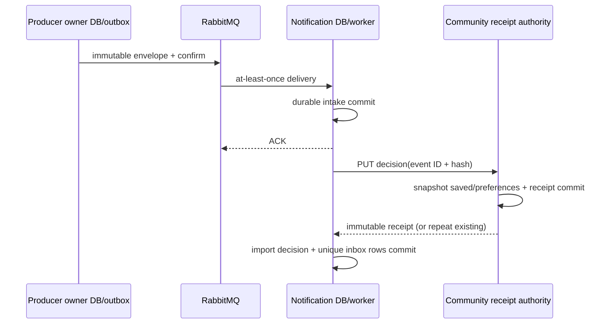

# Events v1 — outbox, recipients, replay

Authority [ADR-0002](../../../docs/adr/0002-v2-contracts.md), gồm receipt
clarification owner đã duyệt. RabbitMQ chỉ transport; không authz authority.

## Envelope

Required JSON:
`{eventId:UUID,type:string,schemaVersion:1,producer:"catalog"|"community"|"notification",
aggregateType:string,aggregateId:UUID,aggregateVersion:integer≥1,
occurredAt:timestamp,correlationId:UUID,causationId:UUID|null,payload:object}`.

Identity `(producer,eventId)` immutable; same identity different canonical
payload/envelope hash →quarantine `EVENT_ID_CONFLICT`, không overwrite.
`occurredAt` là producer domain commit time, không recipient evaluation time.
UUID user refs không email/tokens/body password. Unknown event version/type
quarantine, không skip/ack success giả. Additive optional fields compatible.

| type / producer / aggregate | Payload v1 | Consumers / effect |
| --- | --- | --- |
| `catalog.restaurant.offerings_changed` / catalog / restaurant | {restaurantId,changes:[{offeringId,dishId,kind:"price"|"added"|"removed",oldPriceVnd:null|integer≥0,newPriceVnd:null|integer≥0}]} | Notification: restaurant_update receipt/delivery |
| `community.saved_restaurant.changed` / community / profile | {userId,restaurantId,saved:boolean,revision:integer≥1} | Notification: follow projection only |
| `community.preferences.changed` / community / profile | {userId,notifications:{reply,mention,restaurantUpdate,adminBroadcast},revision:integer≥1} | Notification: advisory projection; never final eligibility |
| `community.interaction.created` / community / comment | {interactionId,actorId,target,parentId:null|UUID,replyRecipientId:null|UUID,mentionIds:UUID[]} | Notification: one combined reply/mention decision |
| `notification.broadcast.queued` / notification / broadcast | {broadcastId,actorId,revision:integer≥1} | Notification worker: broadcast recipient receipt |

Catalog changes only when effective public menu changes: price of public offering,
add/remove offering when endpoints public. Draft edits don't emit notification.
Publishing/unpublishing that adds/removes public offering counts; aggregate multiple
offerings changed by one command into one restaurant event. Mere photos/names/
descriptions don't count. Removal payload holds IDs/prices, no leaked draft text.
Unpublish may make deep link unavailable; fallback, not content snapshot leak.
Saved dish need not follow event; saved restaurant revision guards projection.
Interaction ID = root/reply comment ID. Parent reply recipient resolved by Community,
not browser userId; mentions sorted unique≤10, actor excluded during decision.
Theo remediation approval mới, edit/delete/moderation do not re-emit creation;
consumer checks current visibility before materialization, inaccessible target
has no sensitive preview. Creation recipient refs (reply author/mention IDs) bất
biến trong producer outbox; edit thêm/thay mention không thay payload hoặc tạo
recipient mới cho event đang chờ. Không lấy mentions hiện tại thay refs creation.

## Producer/delivery protocol

1. Owner DB transaction commits domain mutation + outbox envelope, unique eventId.
2. Dispatcher publishes persistent message to durable exchange/queue using publisher
   confirms + mandatory routing; unroutable/nack/connection loss keeps pending.
   Confirm updates outbox sentAt after response; loss after publish →redelivery.
3. Consumer validates version/hash; transaction inserts durable intake record with
   unique producer/eventId. ACK only after durable intake commit.
4. Durable worker claims intake with lease/CAS; broker ACK does not mean inbox
   materialized. Crash reclaims lease; completed/empty decision stays completed.
5. DLQ state is visible non-success; preserve original event identity and reason.

RabbitMQ topology local default: topic exchange `gmf.events.v1`, intake queue
`notification.events.v1`, routing keys exact event types; separate retry/DLQ
`notification.retry.v1`/`notification.dead.v1`. Broadcast event also outbox-delivered,
not direct fire-and-forget. Dedicated RabbitMQ producer/consumer users/vhost ACLs,
not trust arbitrary published user identity; no browser broker access.

## Authoritative recipient decision — no projection-only fanout

Stable decision key is producer+eventId. Notification passes immutable envelope
and hash to Community PUT decision endpoint using Notification credential.
Community validates producer/type, payload and authoritative interaction refs;
it doesn't accept arbitrary email/user lists as a broadcast audience.

Community owns `recipient_decisions` and child recipients. In **one consistent
local snapshot and transaction**, it computes and freezes:

- Restaurant event: enumerate **all** current savers from Community, apply current
  restaurant-update preference and verified eligibility; stale/missing projection
  may not reduce candidates. Event includes only restaurant reference.
- Interaction: validate stored interaction/target/parent author; recipient IDs
  từ immutable creation envelope do producer gửi (không re-read edited mentions
  thành recipients mới). Evaluate reply/mention booleans hiện tại independently,
  exclude actor, union per user.
  If reply disabled but mention enabled, one item with mention group remains.
- Broadcast: all eligible verified profiles with adminBroadcast enabled; actor
  excluded. Only server-created queued broadcast invokes decision.

Insert immutable receipt and complete result (including empty) atomically before
HTTP response; same key+hash returns existing decision, hash mismatch409.
First successful snapshot commit is **decidedAt**, approved “lúc xử lý”.
Before that point saved/preferences changes affect result; after it they do not
cancel pending delivery. Response loss → GET/retry same receipt, no recomputation.
No database transaction across HTTP. Notification projection is optional hint;
not recipient authority, authz source or completeness gate.

Full receipt materialized in Community before serving pages. Receipt pages
limit≤50, userId asc, cursor tied receipt ID; all pages immutable. For demo dataset,
one transaction freezes full set, not a new snapshot per page. Future scale change
needs review; no assumed unlimited fanout capacity on Nano.

Notification copies receipt to own decision rows then inserts inbox recipient
rows and processed state transactionally. Large-page import can stage idempotent
rows; set import complete only after all frozen pages, then materialize unique
rows. Crash resumes existing receipt/import, never fetches new live recipients.
Unique `(sourceKind,sourceId,userId)` makes reply+mention one item, event replay
one item, send retry one broadcast source. `readAt` is never reset on replay.
Community outage →pending retry, not zero recipients or projection fallback.

## Ordering, retry và DLQ

- No global ordering claim. Projection upserts only newer per-user revision;
  delayed unsave/save can't regress projection. Duplicate version same hash no-op;
  conflicting hash quarantine. Different restaurant events remain distinct sources.
- Projection gaps trigger authoritative resync from Community HTTP, not SQL.
  Recipient fanout does not wait for projection watermark.
- Intake transient failure uses bounded exponential backoff local defaults
  1s/5s/30s/120s/600s then dead state; jitter, no busy requeue. Dependency outage
  may be resumed manually after recovery, not report completed. Poison schema/
  identity failures immediate quarantine. Retry budget tunable only with tests.
- Replay is explicit operator action after cause resolved, preserve eventId/
  producer/payload and receipt, record operator/time/reason. Not a public endpoint
  and not startup behavior. No replay/cleanup run in60.

## Retention

| Data | Policy V2 |
| --- | --- |
| Published outbox payload | 30d from confirmed sentAt; unsent is not age-purged as sent |
| Failed payload/DLQ | 30d from entry; archive/expiry status recorded; no silent success |
| Inbox/read state | no automatic purge |
| Comment author-delete tombstone/moderation audit | no automatic purge; body cleared on author delete |
| Processed identities/source dedup keys/recipient receipts | no automatic purge, even if payload expires |
| Receipt recipient rows and immutable empty result | retain with receipt; cannot recompute on replay |
| Active sessions/operations | security expiry/revocation applies; no active authority inferred from record retention |

Payload expiry doesn't authorize replay with a new event ID. Beyond payload
retention require separately reviewed recovery procedure; unknown expired input
is blocked, not reconstructed by guessing. No arbitrary replay against main
Cloud project without operation approval.

Required tests62/103/104/108: duplicate/ordering/payload conflict; broker/DB/HTTP
fault before/after each commit/ACK/confirm; receipt response loss; immutable zero;
new save absent projection; all reply/mention preference combinations; late event
before/after decidedAt; read-state replay; expired payload blocking; service ACLs.
