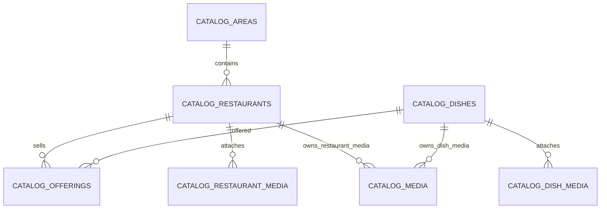
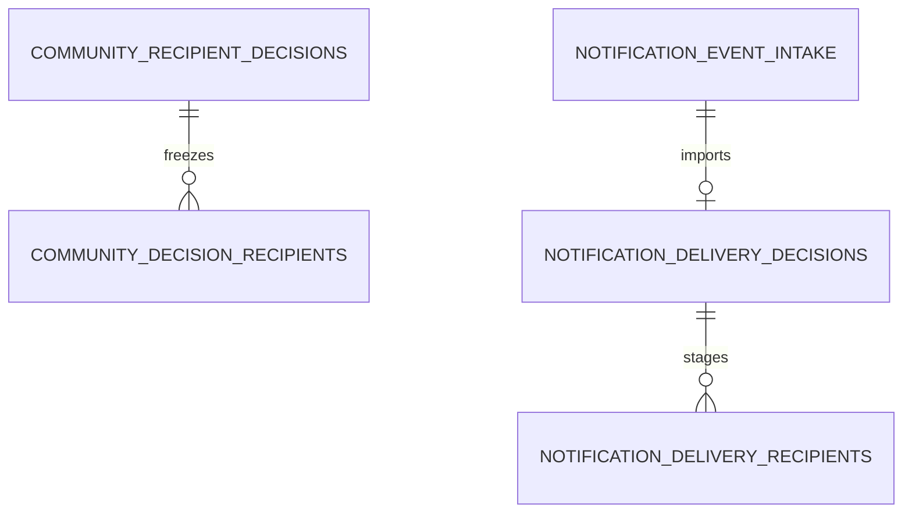

# Data model — SCRUM-60 design, no applied migration

> **Owner-approved security simplification 2026-11-19:** Supabase Auth owns
> account/session behavior. The Community custom `app_sessions`,
> `auth_contexts`, and `credential_operations` records and C09–C11 advanced
> session/credential constraints below are historical and superseded. Do not
> implement them. Preserve the Community profile/business data, service-owned
> tables, Storage metadata, and all unrelated data contracts. Any remaining
> account-to-profile linkage uses the Auth user ID as an external reference;
> there is no FK into Supabase Auth internals.

Nguồn [spec](spec.md), [contracts](contracts/README.md), ADR-0001/0002.
Schema boundaries là ràng buộc bắt buộc; bảng dưới là thiết kế không phải kết quả
`list_tables` mới. Cloud Auth giữ email/password/verification primitives; app
không tạo FK vào `auth.users`, không SQL `auth.sessions`/Storage internals.

## Field conventions / constraints để chuyển nguyên văn sang tasks

Mỗi block Cxx là normative migration/validation constraint. Fields không ghi `?`
đều NOT NULL; `?` nullable. UUID PK `id`, timestamps UTC `created_at/updated_at`
áp dụng mọi domain row trừ composite PK được ghi rõ. Revisions bắt đầu1, tăng
trong owner transaction. Metadata/hashes không được chứa password/raw handle.

**C00**: Fields không ghi `?` đều NOT NULL; `?` nullable. UUID PK `id`, timestamps UTC `created_at/updated_at` áp dụng mọi domain row trừ composite PK được ghi rõ. Revisions bắt đầu1, tăng trong owner transaction. Metadata/hashes không được chứa password/raw handle.

## Catalog — owner/runtime role Catalog

| Entity | Fields ngoài C00 | Quan hệ/index |
| --- | --- | --- |
| dishes | name:text, description:text, status:publication, is_demo:boolean, revision:int | status/name/id; category links |
| restaurants | name:text, description:text, address:text, area_id:UUID, status:publication, is_demo:boolean, revision:int | FK areas; status/area/name/id |
| offerings | dish_id:UUID, restaurant_id:UUID, price_vnd?:bigint, available:boolean, revision:int | FK dishes/restaurants; pair unique; dish/restaurant/available/price |
| categories / areas | name:text, normalized_name:text | normalized_name/id search |
| dish_categories | dish_id:UUID, category_id:UUID | composite PK; both local FK |
| media | object_key:text, dish_id?:UUID, restaurant_id?:UUID, state:media_state, mime:text, byte_size:bigint, source:text, license:text | object_key unique; XOR owner local FK; pending state |
| dish_media / restaurant_media | entity_id:UUID, media_id:UUID, position:int | composite PK; local FK; position≥0 |
| outbox | xem shared reliability dictionary | producer=Catalog |

**C01**: publication ∈ {draft,published}; name/address khi có phải nonempty sau trim; is_demo=true cho demo content; không giá/vị trí/rating tự suy ra.

**C02**: price_vnd nullable hoặc integer≥0; UNIQUE(dish_id,restaurant_id); public offering cần available=true và cả dish/restaurant published; filter area/price/category cùng một offering.

**C03**: media_state ∈ {pending,ready,failed}; byte_size≤5242880 và >0; mime ∈ {image/jpeg,image/png,image/webp}; object_key unique; catalog source/license nonempty; chỉ attach media ready thuộc đúng owner.

Owner-approved draft-first: `media` luôn thuộc đúng một dish hoặc restaurant đã
tồn tại: CHECK XOR hai FK local, không owner-null staging. Ownership không phải
attachment: upload xong vẫn chưa gắn; `dish_media`/`restaurant_media` chỉ gắn
đúng owner nhờ composite local FK. DB XOR/FK không tự bảo đảm state `ready`.
Service kiểm ready/owner/revision trong transaction attach và phối hợp khóa với
state update; recheck lúc publish và mọi request ảnh. Không tự xóa attachment
hoặc đổi publication state khi media mất ready; không expose bytes/DTO trái điều kiện.
Publish cho phép zero ảnh nhưng reject nếu bất kỳ attachment nào invalid.

Mỗi media có đúng một trong hai quan hệ owner; ERD không thể hiện XOR trực tiếp.
Media ownership và attachment là quan hệ khác nhau.

Publication chỉ expose validated ready media; draft bytes không public bypass.
Catalog/Community media đọc qua owner-authorized proxy routes; storage bucket private,
không public raw object URL/signed private URL giao browser bypass ledger.
`Media.url` là owner proxy URL qua BFF/Gateway, public content recheck publication;
avatar public DTO chỉ expose sanitized avatar, không session-private bytes.
Storage policy/bootstrap chi tiết được test ở69/71, không mutate ở60.

Search normalized Vietnamese expression/index thuộc Catalog; search index chỉ
published/available paths, bigint numeric sorting null-last. Không cross-schema join.

## Community — owner/runtime role Community

| Entity | Fields ngoài C00 | Quan hệ/index |
| --- | --- | --- |
| profiles | auth_user_id:UUID, display_name:text, handle?:text, avatar_media_id?:UUID, verified:boolean, role:app_role, revision:int | auth_user_id unique external ref; handle unique nonnull; local media FK |
| preferences | profile_id:UUID, theme:theme, reply:boolean, mention:boolean, restaurant_update:boolean, admin_broadcast:boolean, revision:int | profile_id unique local FK |
| onboarding | profile_id:UUID, state:onboarding_state, step?:text | profile_id unique local FK |
| avatar_media | object_key:text, profile_id:UUID, state:media_state, mime:text, byte_size:bigint | object_key unique; local profiles FK |
| saved | profile_id:UUID, target_type:target_type, target_id:UUID, revision:int | unique(profile_id,target_type,target_id); listing/profile/type/created_at |
| saved_sets | profile_id:UUID, target_type:target_type, revision:int, previous_target_id?:UUID | composite PK; serializes random/unsave CAS |
| comments | author_id:UUID, target_type:target_type, target_id:UUID, parent_id?:UUID, body?:text, author_deleted:boolean, moderator_hidden:boolean, revision:int | local profile/self FK; target/parent/created_at/id |
| mentions | comment_id:UUID, mentioned_profile_id:UUID | composite PK; local FKs |
| reports | comment_id:UUID, reporter_id:UUID, reason:text, state:report_state | local FKs; state/created_at/id |
| moderation_audit | comment_id:UUID, actor_id:UUID, action:text, reason:text, previous_hidden:boolean, new_hidden:boolean | local FKs; append-only |
| recipient_decisions | producer:text, event_id:UUID, input_hash:bytes, decided_at:timestamp, recipient_count:int | unique(producer,event_id); immutable including count0 |
| decision_recipients | decision_id:UUID, profile_id:UUID, groups:text[] | composite PK; local FKs; immutable |
| idempotency_keys | profile_id:UUID, operation:text, request_id:UUID, input_hash:bytes, resource_id:UUID | unique(profile_id,operation,request_id) |
| outbox | shared reliability dictionary | producer=Community |

**C04**: display_name trim2..60 Unicode code points; handle nullable trước chọn, sau chọn phải ^[a-z0-9_]{3,30}$, UNIQUE và immutable.

**C05**: theme ∈ {light,dark,system}; app_role ∈ {user,admin}; onboarding_state ∈ {not_started,in_progress,skipped,completed}; notification groups là bốn boolean độc lập; step nullable được giữ khi skipped.

**C06**: target_type ∈ {dish,restaurant}; UNIQUE(profile_id,target_type,target_id) cho saved; target_id external UUID không cross-service FK; random previous per(profile_id,target_type), CAS saved_set revision, không filters/fallback.

**C07**: visible comment body trim1..2000 code points, ≤10 unique mentions theo profile ID có handle; parent chỉ root cùng target; không reply dưới reply; author_deleted xóa body/mentions, giữ tombstone và replies khác; moderator_hidden không được restore body author_deleted.

**C08**: report_state ∈ {open,resolved}; reason nonempty plain text; moderation audit append-only; admin chỉ hide/restore, không sửa body; reply creation cần parent visible.

**C09**: Supabase Auth là authority cho credentials/account sessions; Community profile giữ external `auth_user_id` reference duy nhất, không FK vào Auth internals; app không có custom session ledger/token custody.

**C10**: Email verification, password recovery, and callback behavior use Supabase Auth supported flows; no custom account-session context ledger or stronger provider guarantees.

**C11**: Password change/reset and logout use Supabase Auth supported operations; do not add custom credential-operation state, refresh fencing, or durable global revocation; do not claim immediate invalidation beyond provider behavior.

**C12**: recipient receipt UNIQUE(producer,event_id), input_hash immutable, recipient_count≥0; decision_recipients PK(decision_id,profile_id), groups nonempty subset{reply,mention,restaurant_update,admin_broadcast}; snapshot đầy đủ saved/preferences bền vững trước HTTP response; retry reuse cả empty decision.

**C13**: idempotency UNIQUE(profile_id,operation,request_id); same key different input hash là conflict, không duplicate mutation/event; không persist password hoặc password-derived retry hash.

Default preferences new profile: theme=system; bốn nhóm reply, mention,
restaurant_update (cập nhật quán đã lưu), admin_broadcast (broadcast quản trị)
enabled theo **remediation approval mới**, không thuộc approval6/6 trước.
Onboarding not_started/step null, handle null đến owner chọn, role user qua
supported bootstrap. Test own-user persistence, không tự trao admin.
Email không nằm public profile; verified mirrored only from provider
proof, admission refresh synchronizes status; admin granted only approved bootstrap.
Session expiry/logout follow Supabase Auth-supported behavior; the application
does not persist an all-session revocation ledger.

## Notification — owner/runtime role Notification

| Entity | Fields ngoài C00 | Quan hệ/index |
| --- | --- | --- |
| broadcasts | actor_id:UUID, title:text, body:text, state:broadcast_state, revision:int, queued_at?:timestamp | external actor ref; state/created_at/id |
| inbox | source_kind:text, source_id:UUID, recipient_id:UUID, groups:text[], target_type?:target_type, target_id?:UUID, comment_id?:UUID, broadcast_id?:UUID, read_at?:timestamp | unique(source_kind,source_id,recipient_id); recipient/created_at/id + unread partial |
| event_intake | producer:text, event_id:UUID, input_hash:bytes, envelope?:json, state:intake_state, attempt:int, lease_until?:timestamp, next_attempt_at?:timestamp, error_code?:text | unique(producer,event_id); pending/next_attempt |
| delivery_decisions | producer:text, event_id:UUID, receipt_id:UUID, input_hash:bytes, decided_at:timestamp, import_complete:boolean | unique(producer,event_id); immutable authority fields |
| delivery_recipients | decision_id:UUID, user_id:UUID, groups:text[] | composite PK, local decision FK |
| follow_projection | user_id:UUID, restaurant_id:UUID, saved:boolean, revision:int | composite PK; restaurant/saved; advisory only |
| preference_projection | user_id:UUID, groups:json, revision:int | user_id PK; advisory only |
| processed_events | producer:text, event_id:UUID, input_hash:bytes, completed_at:timestamp | composite PK; never payload-TTL-purged |
| replay_audit | event_id:UUID, producer:text, operator_ref:text, reason:text, outcome:text | append-only, no tokens/PII payload |
| outbox | shared reliability dictionary | producer=Notification (broadcast) |

**C14**: broadcast_state ∈ {draft,queued,sent}; title trim1..120/body trim1..2000 code points plain text; queued revision immutable; send idempotent by requestId; admin checked at send.

**C15**: inbox UNIQUE(source_kind,source_id,recipient_id); groups union reply+mention; self-recipient excluded; read_at nullable, once set not reset by replay; all-read only rows in transaction snapshot; no automatic inbox purge.

**C16**: intake_state ∈ {pending,processing,completed,dead}; attempt≥0; event identity/hash immutable; ACK after durable intake commit; processed_events/delivery_decisions retained without automatic purge; importing recipient pages must finish before completion.

**C17**: projections accept only newer revision; external IDs no cross-service FK; authoritative Community enumeration cannot be restricted by projection; Community unavailable means pending, not empty/fallback.

## Shared owner-local reliability dictionary

Each service's own `outbox`: id/event_id UUID unique, aggregate_type text,
aggregate_id UUID, aggregate_version integer, event_type text, schema_version
integer, payload JSON, occurred_at timestamp, correlation_id UUID, causation_id?
UUID, sent_at? timestamp, attempts integer, next_attempt_at? timestamp,
last_error_code? text. No cross-schema shared table. Canonical envelope in events.md.

**C18**: domain change+outbox atomic; aggregate_version≥1, schema_version=1, attempts≥0; publisher confirm không consumer commit; sent payload giữ30d từ sent_at, unsent không age-purge như sent.

**C19**: failed payload/DLQ giữ30d; dedup keys/recipient receipts/inbox/tombstone/moderation audit không automatic purge; replay giữ event ID và read state, quá hạn payload cần quy trình riêng.

**C20**: runtime roles riêng chỉ own schema DML/sequence cần thiết, không DDL/owner/superuser; migration principal riêng≤1 khi duyệt; không cross-service SQL/joins/FK hoặc FK Auth/Storage internals; DB TLS chain+hostname; pool caps Catalog4/Community4/Notification2.

## Remediation constraints — authority mới, không hồi tố approval6/6

**C21**: defaults reply/mention/restaurant_update/admin_broadcast=true; reply/mention chỉ phát khi tạo comment/reply, không phát lại khi edit; creation recipient refs bất biến, preferences vẫn xét tại recipient decision.

**C22**: media GET phải recheck ready/publication/attachment hoặc ledger+ownership mỗi request; draft Catalog chỉ Admin, unattached avatar chỉ chính chủ; private Storage, no signed URL tới browser; Cache-Control private,no-store; không304/shared cache.

**C23**: Auth verification, password recovery, and account-session behavior remain with Supabase Auth supported APIs; Gateway validates JWTs; no custom operation/session ledger or stronger revocation claim. Retain server-side secret handling, TLS verification, input validation and basic authorization.

The earlier C23 operation-proof/attempt-fencing specification is superseded by
the 2026-11-19 owner amendment and is not a schema or implementation requirement.
No cross-service FK; Auth user IDs remain external references.

## ERD bổ sung cho delivery

Đường HTTP receipt không là FK trong diagram. Data tests phải chứng minh local
FK/CHECK/unique/partial index/triggers hoặc transaction invariants tương ứng;
app validation không thay DB uniqueness. Không tạo migration ở60.
